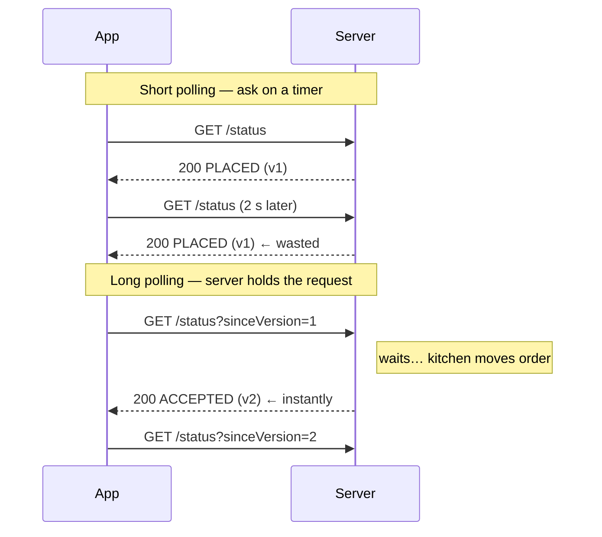

# Exercise 02 (Go) — Short Polling vs Long Polling

**Port:** 8082  **You'll learn:** why "just call the API every 2 seconds" is wasteful *and* slow, and how long polling fixes both

---

## The Story
After placing an order, the QuickBite app displays a live tracker:
`PLACED → ACCEPTED → PREPARING → OUT_FOR_DELIVERY → DELIVERED`.
The server's background kitchen worker advances each order independently every ~3 seconds (with random jitter). How does the frontend client discover state transitions?



---

## The Experiment (Empirical Scorecard)

| Mode | HTTP Requests | Wasted Calls (No News) | Avg Notice Delay | Missed State Changes |
|---|---|---|---|---|
| **Short 500 ms** | ~24 | ~20 | ~250 ms | 0 |
| **Short 2000 ms** | ~7 | ~3 | ~1050 ms | 0–1 |
| **Short 5000 ms** | ~3 | 0 | ~2400 ms | 1–2 (Steps Skipped!) |
| **Long Polling** | **4** | **0** | **~10 ms** | **0** |

Running short polling with a long interval (e.g. 5000 ms) demonstrates dropped transitions: the order moves through `ACCEPTED` and `PREPARING` before the client asks, skipping states entirely.

---

## How Go Simplifies Long Polling

In Java, long-polling often requires `ReentrantLock` + `Condition` variables or blocking thread pools, which easily lead to thread starvation unless virtual threads are configured.

In Go:
- **Channels & Goroutines**: When a long-poll request arrives and no update is available, we simply append a `chan struct{}` to a slice of listeners.
- **Select Statement**: `select { case <-ch: ... case <-time.After(timeout): ... }` handles both immediate event wakeups and timeouts cleanly without race conditions.
- **Micro-Footprint**: Go goroutines consume only ~2 KB of stack space, allowing a single server instance to handle 50,000+ parked long-poll connections without breaking a sweat.

---

## Think & Answer (Interview Questions)

### 1. Short polling has one knob (interval). What do you trade when you turn it down? When you turn it up?
* **Turn down (e.g. 500 ms)**: Low notice delay (fresher UI), but massive traffic amplification, high server CPU load, and lots of wasted requests.
* **Turn up (e.g. 5000 ms)**: Low server load, but high UI lag and missed intermediate status changes (e.g., skips `ACCEPTED` or `PREPARING`).

### 2. 1 million users each polling every 2 s — how many requests/second hit your servers, and how many are wasted?
* **500,000 req/sec** hit the servers. If an order advances 4 times across a 15-minute delivery (450 polls per user), only 4 requests contain news. **>99% (~495,000 req/sec) are completely wasted empty checks.**

### 3. Long polling holds a request open for up to 30 s. Why are goroutines ideal for this? What breaks with traditional thread pools?
* In traditional thread-per-connection pools (e.g., fixed pool of 8 threads), 8 parked long-polling clients monopolize all threads. The 9th request hangs or times out due to thread pool exhaustion.
* Go **goroutines** use dynamic, contiguous stacks starting at ~2 KB and yield automatically when blocked on channels or timers. A single machine can park 50,000+ concurrent requests using negligible memory and zero CPU while waiting.

### 4. Why wake up ALL listeners (`close(ch)`) instead of just one?
* Multiple clients or devices may track the same order simultaneously (customer phone, web browser, delivery rider, customer support agent). Waking only one connection would leave other viewers permanently stale. Closing the channel broadcasts the wake-up to all waiting goroutines simultaneously.

### 5. Why does the client send `sinceVersion` instead of the server remembering "what this client last saw"?
* Keeps the server **stateless**. The request can be routed to any instance behind a load balancer without needing distributed session affinity. It also makes retries and network reconnects naturally idempotent.

### 6. Load balancers and proxies often kill idle connections after ~60 s. How does the timeout + 204 design survive that?
* The server proactively completes the request before the proxy's idle timeout (e.g., after 25–30 s) with `204 No Content`. The client immediately re-establishes a fresh request, preventing abrupt TCP resets (`ECONNRESET` or 504 Gateway Timeout).

### 7. When is plain short polling still the RIGHT choice? (Hint: a report that takes 10 minutes to generate)
* When updates are very infrequent or take a long time (e.g. generating a 10-minute CSV export or batch video rendering), when the client is simple (e.g. a curl script or cron job), or when clients connect through aggressive corporate proxies that disallow long-held connections.

---

## How to Run

### 1. Start Server
```bash
go run ./02-polling/server/main.go
```

### 2. Run Client (in another terminal)

**Short Polling (e.g. check every 2 seconds):**
```bash
go run ./02-polling/client/main.go short 2000
```

**Long Polling:**
```bash
go run ./02-polling/client/main.go long
```

### 3. Run Automated Tests
```bash
go test -v ./02-polling/...
```
