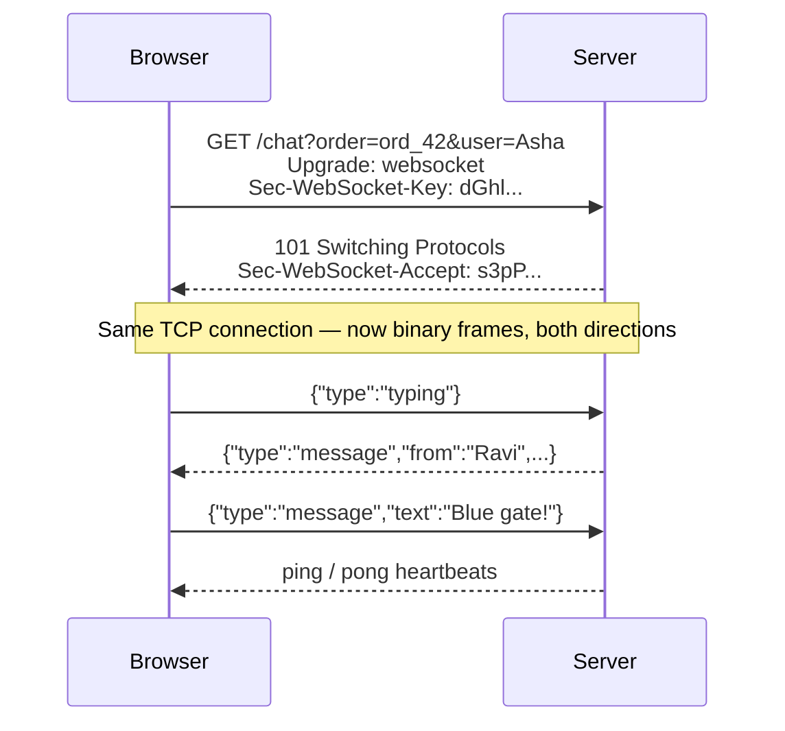

# Exercise 04 (Go) — WebSockets (Built from Raw Sockets)

**Port:** 8084  **You'll learn:** the HTTP upgrade handshake, RFC 6455 framing, full-duplex messaging, XOR masking, chat rooms & broadcast

---

## The Story
The delivery rider cannot find the customer's gate. They need to **chat** — both sides sending messages at any moment, complete with "typing…" indicators. SSE is one-way; polling is too slow. It's time for a bidirectional **WebSocket**.

We build this server using Go's raw TCP network listener (`net.Listen("tcp", ...)`) without any third-party framework so you can inspect the exact protocol mechanics:



---

## The WebSocket Protocol (RFC 6455)

### 1. The HTTP Upgrade Handshake
A WebSocket connection begins as an ordinary HTTP/1.1 request:

```http
GET /chat?order=ord_42&user=Ravi HTTP/1.1
Host: localhost:8084
Upgrade: websocket
Connection: Upgrade
Sec-WebSocket-Key: dGhlIHNhbXBsZSBub25jZQ==
Sec-WebSocket-Version: 13
```

To prove the server speaks WebSocket, it hashes the client's key with the RFC magic GUID (`258EAFA5-E914-47DA-95CA-C5AB0DC85B11`) using SHA-1:
```http
HTTP/1.1 101 Switching Protocols
Upgrade: websocket
Connection: Upgrade
Sec-WebSocket-Accept: s3pPLMBiTxaQ9kYGzzhZRbK+xOo=
```
From this point forward, the TCP socket stops speaking HTTP and switches to bidirectional binary framing.

---

### 2. Binary Frame Structure
Every message is transmitted in binary frames:

```text
 0                   1                   2                   3
 0 1 2 3 4 5 6 7 8 9 0 1 2 3 4 5 6 7 8 9 0 1 2 3 4 5 6 7 8 9 0 1
+-+-+-+-+-------+-+-------------+-------------------------------+
|F|R|R|R| opcode|M| Payload len |    Extended payload length    |
|I|S|S|S|  (4)  |A|     (7)     |             (16/64)           |
|N|V|V|V|       |S|             |   (if payload len==126/127)   |
| |1|2|3|       |K|             |                               |
+-+-+-+-+-------+-+-------------+ - - - - - - - - - - - - - - - +
|     Masking-key, if MASK set to 1 (4 bytes, client->server)   |
+-------------------------------+-------------------------------+
|                     Payload Data (XOR masked)                 |
+---------------------------------------------------------------+
```

---

## Think & Answer (Interview Questions)

### 1. Why does WebSocket start as HTTP at all? (Think: port 443, firewalls, proxies, existing load balancers)
* Corporate firewalls, reverse proxies, and NAT gateways generally allow traffic on ports 80 (HTTP) and 443 (HTTPS), while blocking arbitrary non-HTTP TCP ports.
* Starting as a standard HTTP `GET` with an `Upgrade: websocket` header allows the handshake to traverse existing networking infrastructure, API gateways, and firewalls without requiring custom open ports. Once the server returns `101 Switching Protocols`, both sides switch the exact same TCP socket to binary frame mode.

### 2. Why must browser $\to$ server frames be masked? (Search: "cache poisoning" attack on proxies)
* To prevent **cache poisoning attacks** on intermediate transparent proxies.
* If an unmasked frame sent by a malicious browser script happened to contain bytes formatted like an HTTP `GET /page.html HTTP/1.1`, an intermediary proxy that failed to understand the WebSocket upgrade could misinterpret the payload as an HTTP request and cache malicious responses for subsequent users.
* XOR-masking client frames with a 4-byte random key (`payload[i] ^= mask[i % 4]`) ensures data on the wire is scrambled and cannot be interpreted as an HTTP command by intermediate proxies. Server $\to$ client frames are unmasked because the server is trusted.

### 3. Our `rooms` map lives in one process. With 3 server instances behind a load balancer, Asha lands on server A and Ravi on server B. What breaks? How do Redis Pub/Sub or Kafka fix it? What are "sticky sessions"?
* **What breaks**: Server A only holds Asha's TCP socket; Server B only holds Ravi's TCP socket. When Ravi sends a message, Server B has no local reference to Asha, so Asha never receives it.
* **How Redis Pub/Sub / Kafka fixes it**: Servers publish room messages to a distributed message broker (e.g. Redis channel `room:ord_42`). Every server instance subscribes to active room channels; when Server A receives the Redis event, it broadcasts to Asha.
* **Sticky sessions**: Routes requests from the *same client* to the same server instance. Sticky sessions do not fix multi-user chat because Asha and Ravi are two separate users.

### 4. The server holds one open TCP connection per user. Roughly how many can one box hold, and what limits it (memory, file descriptors, threads)?
* A tuned Linux/Go server can hold **100,000 to 1,000,000+** concurrent idle WebSocket connections.
* **File Descriptors**: Each socket requires a file descriptor. The OS default (`ulimit -n 1024`) must be tuned up into the hundreds of thousands.
* **Memory**: Each TCP socket requires kernel read/write socket buffers (typically 4 KB–16 KB). 100,000 connections require ~1.5 GB of RAM.
* **Threads / Goroutines**: Traditional 1-thread-per-connection architectures exhaust memory at a few thousand threads (1 MB stack each). Go **goroutines** start with ~2 KB stacks and unmount from OS threads when waiting, scaling easily to hundreds of thousands of concurrent connections.

### 5. Ping/pong: who should send pings, and what happens to the room if a phone goes into a tunnel and never sends a Close frame?
* The **server** sends periodic `PING` control frames (e.g. every 20–30 s).
* If a phone abruptly enters a subway tunnel, the connection enters a "half-open" state where no `CLOSE` or `FIN` packet is transmitted. Without heartbeats, the server would keep the dead socket and user in the room indefinitely.
* When the client fails to answer with a `PONG` within a timeout (e.g. 10 s), the server terminates the socket, cleans up the room, and broadcasts `<user> left`.

### 6. Chat over WebSocket vs chat over "POST to send + SSE to receive". When is the second one actually better?
* **POST + SSE is better when**:
  * You want standard HTTP middleware for authentication, rate-limiting, and caching on outgoing messages.
  * You want natural idempotency on message sends via `Idempotency-Key` headers.
  * Your clients run in restrictive corporate environments where WebSockets are blocked by proxies, but HTTP/2 SSE works seamlessly with multiplexing.
  * Built-in automatic reconnection with `Last-Event-ID` message replay is needed without building custom application-level heartbeat protocols.

---

## How to Run

### 1. Start Chat Server
```bash
go run ./04-websockets/server/main.go
```
The server will start on `http://localhost:8084`.

### 2. Test in Web Browser
Open `http://localhost:8084` in two separate browser tabs to chat in real-time. Notice the "user is typing..." indicator and live online member list!

### 3. Test in Terminal (CLI Client)
In another terminal, connect via the CLI client:
```bash
go run ./04-websockets/client/main.go Rider_Ravi ord_42
```

### 4. Run Automated Tests
```bash
go test -v ./04-websockets/...
```
