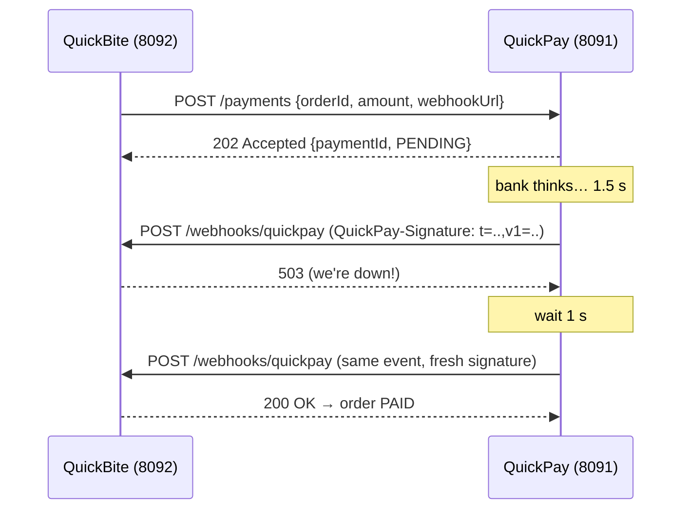

# Exercise 05 (Go) — Webhooks (Sending *and* Receiving)

**Ports:** 8091 (QuickPay gateway), 8092 (QuickBite merchant)  **You'll learn:** server-to-server callbacks, HMAC-SHA256 signatures, replay protection, retries with exponential backoff, at-least-once delivery & idempotent consumers

---

## The Story
QuickBite charges customers through **QuickPay** (a simulated Razorpay/Stripe). Charging a card takes time, so QuickPay answers `202 Accepted` immediately and **calls QuickBite back** when the bank decides.

That callback is a webhook: *"don't call us, we'll call you."* It's just an HTTP POST — but from the *server* to *your* server. Which means: anyone on the internet can also POST to your webhook URL.



---

## How Webhooks Work (Architecture & Security)

### 1. The Core Idea: "Don't Call Us, We'll Call You"
* **Polling**: The merchant repeatedly queries `GET /payments/{id}` every 2 seconds. Most calls return "PENDING", burning server CPU, bandwidth, and battery.
* **Webhook**: The merchant passes a `webhookUrl` to the payment gateway once and says: *"Call me as soon as the bank settles."* When the event occurs, the gateway makes an HTTP `POST` to the merchant's URL.

### 2. End-to-End Execution Flow
1. **Initiate Payment (Non-blocking)**: QuickBite calls `POST /payments` on QuickPay with the order details and `webhookUrl`.
2. **Immediate Acknowledgment**: QuickPay responds with **`202 Accepted`** (`status: PENDING`) immediately — never blocking for slow bank networks.
3. **Asynchronous Settlement**: QuickPay processes the charge with the card network/bank (takes 1–3 seconds).
4. **The Webhook Callback**: QuickPay signs the payload and makes an HTTP `POST` to QuickBite's `webhookUrl`.
5. **Verification & Update**: QuickBite verifies the cryptographic signature in constant time, deduplicates the event ID, updates the order to `PAID`, and answers with **`200 OK`**.

### 3. The Security Layer (Defending a Public Endpoint)
Because webhook receivers are publicly accessible over the internet, anyone could attempt to POST fake `"payment.succeeded"` events. We secure it with three defenses:

* **HMAC-SHA256 (Authenticity & Integrity)**: Both servers share an out-of-band secret (`WEBHOOK_SECRET`). The gateway signs the payload using `HMAC_SHA256(secret, t + "." + rawBody)`. If an attacker tampers with even a single byte of the payload or amount, the signature fails verification (`401 Unauthorized`).
* **Timestamp `t` (Stopping Replay Attacks)**: Including the timestamp `t` inside the signed payload cryptographically locks the signature to a point in time. The merchant checks `|now - t| <= 300` seconds (5 min). An attacker who intercepts a legitimate signed payload cannot replay it hours or weeks later.
* **Constant-Time Comparison (`hmac.Equal`)**: Standard string comparison short-circuits on the first mismatched byte, allowing attackers to guess signatures byte-by-byte via microsecond timing differences (timing attacks). `hmac.Equal` always executes in constant time.
* **Raw Body Verification**: Verification is computed strictly against the **raw body bytes**, not re-serialized JSON (since JSON key order and spacing are non-deterministic).

### 4. The Reliability Layer (Retries & Idempotency)
* **Exponential Backoff**: If the merchant is down (`503`) or unreachable, the gateway retries with growing intervals (`1s, 2s, 4s, 8s`).
* **At-Least-Once Delivery & Idempotent Consumer**: Network retries mean the same event ID will arrive more than once. The merchant records processed event IDs in a thread-safe map.
* **Why answer 200 on duplicates?** Gateways interpret any non-2xx response (including 409 or 400) as a delivery failure and will continue retrying. Answering **`200 OK`** acknowledges receipt and tells the gateway to stop retrying.

---

## Summary Checklist for System Design Interviews

| Security / Design Need | Solution Implemented |
|---|---|
| **Asynchronous Push** | Gateway triggers `POST /webhooks/quickpay` after bank settlement. |
| **Tamper Protection** | `QuickPay-Signature: t=..,v1=HMAC_SHA256(secret, t + "." + rawBody)`. |
| **Replay Protection** | Verified `|now - t| <= TOLERANCE_SECONDS` (5 mins). |
| **Timing Attack Defense** | `hmac.Equal()` constant-time byte comparison. |
| **Gateway Retries** | Exponential backoff (`1s, 2s, 4s, 8s`) up to `MAX_ATTEMPTS = 5`. |
| **Duplicate Delivery** | Thread-safe `processedEvents` map; duplicates answered with `200 OK`. |

---

## Think & Answer (Interview Questions)

### 1. Webhook vs the merchant polling `GET /payments/{id}`. Why do gateways offer both? When do you need the poll anyway? (Hint: what if all 5 retries fail during your deploy?)
* **Why both**: Webhooks provide real-time, event-driven push notifications with zero wasted polling traffic for 99.9% of normal operations. Polling (`GET /payments/{id}`) acts as the essential **reconciliation fallback**.
* **When you need polling**: If the merchant server experiences an extended outage, network partition, or deployment failure that exhausts all gateway retry attempts, the webhook is permanently dropped. A scheduled background reconciliation job (e.g., polling every 5–10 minutes for orders in `PENDING_PAYMENT` > 1 min) queries the gateway to sync final payment states.

### 2. Why HMAC and not just a secret token in a header like `X-Secret: abc`? What does HMAC prove that a token doesn't?
* A static header like `X-Secret: abc` proves *authentication* (who sent it), but provides **zero integrity protection**. An attacker, proxy, or rogue gateway could intercept the request and tamper with the body (e.g. flipping `"status": "FAILED"` to `"status": "SUCCEEDED"` or altering monetary amounts).
* An **HMAC (Hash-based Message Authentication Code)** signs the *entire body payload*. Any tampering with even a single byte invalidates the signature. Thus, HMAC proves both **authenticity** (the sender knows the shared secret) AND **integrity** (the payload was not altered in transit).

### 3. Why is the timestamp inside the signed message? What attack does `TOLERANCE_SECONDS` stop?
* Signing `timestamp + "." + body` binds the signature cryptographically to a specific moment in time.
* It stops a **Replay Attack**. If an attacker intercepts a legitimate webhook (`payment.succeeded` for an order), without a signed timestamp the attacker could replay that exact same captured HTTP request weeks later to trigger repeat order fulfillment. `TOLERANCE_SECONDS` (e.g. 5 minutes) ensures that any captured webhook replayed after 5 minutes is rejected with `401`.

### 4. Why `hmac.Equal` instead of string equality? (Search: timing attack)
* Standard string comparison compares characters sequentially from left to right and short-circuits on the first mismatched character.
* An attacker can measure nanosecond differences in server response times to guess the signature byte-by-byte (a **timing attack**).
* `hmac.Equal` runs in **constant time**, comparing all bytes regardless of where differences occur, completely eliminating timing side-channels.

### 5. Why must you verify against the raw body bytes, not re-serialized JSON?
* JSON serialization is non-deterministic: whitespace, indentation, newline style, and dictionary key order can vary across parsers and libraries (`{"a":1,"b":2}` vs `{"b":2,"a":1}`).
* The HMAC was computed over the sender's exact binary byte stream. Re-serializing parsed JSON changes character byte sequences, yielding a different HMAC hash and causing valid signatures to fail verification.

### 6. On a duplicate, why answer 200 and not 409?
* Webhook delivery guarantees **at-least-once delivery**. Gateways consider any non-2xx HTTP response (including `409 Conflict` or `400 Bad Request`) as a delivery failure and will repeatedly retry sending the duplicate event until max attempts exhaust.
* Answering **`200 OK`** acknowledges receipt and tells the gateway: *"I have processed this event, do not retry it."*

### 7. Your handler takes 8 s because it also sends a confirmation email. What goes wrong with the gateway's 5 s timeout? How do you fix it? (Hint: queue)
* With a 5 s gateway timeout, the gateway aborts the connection, marks the attempt as failed, and triggers retries. Meanwhile, the merchant's server continues running, resulting in duplicate emails and wasted server resources.
* **Fix**: Follow the **Fast ACK + Background Queue** pattern. The webhook endpoint only verifies the signature, writes the event into a persistent message queue (e.g. SQS, RabbitMQ, Kafka, or a database job queue), and immediately returns `200 OK` in <50 ms. Background workers consume the queue to process emails and notifications asynchronously.

### 8. `payment.failed` arrives *after* `payment.succeeded` for the same order (retries reorder things). What should happen? How would you guard against it?
* Network retries and parallel delivery threads can cause events to arrive out of order. If a delayed `payment.failed` overwrites a `payment.succeeded` state, a customer who paid will have their order incorrectly marked failed.
* **Guard**:
  1. **State Machine Invariants**: Enforce one-way status transitions (e.g. `PAID` is terminal and cannot transition backward to `PAYMENT_FAILED`).
  2. **Event Timestamp / Sequence Monotonicity**: Include event creation timestamps or sequence numbers; reject/ignore events older than the order's current state transition.

---

## How to Run

### 1. Start Gateway (Port 8091)
```bash
go run ./05-webhooks/gateway/main.go
```
*(Optional: run with `--duplicate` flag to simulate duplicate deliveries).*

### 2. Start Merchant App (Port 8092)
```bash
go run ./05-webhooks/merchant/main.go
```
*(Optional: run with `--flaky` flag to test automatic retry recovery).*

### 3. Place an Order
```bash
curl -X POST http://localhost:8092/orders \
  -H "Content-Type: application/json" \
  -d '{"amount": 499}'
```
Response: `{"orderId":"ord_701","status":"PENDING_PAYMENT"}`

Wait ~1.5 seconds for the webhook to land, then check the order status:
```bash
curl http://localhost:8092/orders/ord_701
```
Notice `status` has flipped to `"PAID"`!

### 4. Run Automated Tests
```bash
go test -v ./05-webhooks/...
```
