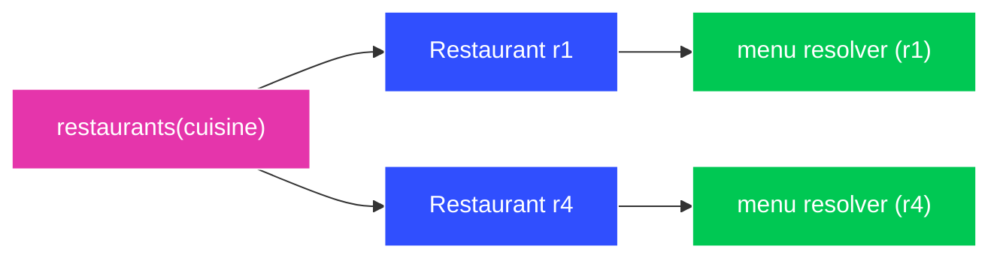

# Exercise 06 (Go) — GraphQL

**Port:** 8086  **You'll learn:** schema-first APIs, queries/mutations/variables, field resolvers, over/under-fetching, the N+1 problem, DataLoader concepts

---

## The Story
The QuickBite **home screen** displays South Indian restaurants with their name, rating, and two vegetarian dishes with prices.

With a traditional REST API:
```bash
curl -s localhost:8086/rest/restaurants | wc -c          # every field of every restaurant…
curl -s localhost:8086/rest/restaurants/r1/menu           # …then one call PER restaurant for menus
```
That creates **over-fetching** (fields you don't need) *and* **under-fetching** (1 + $N$ network round trips). On a mobile phone on a flaky cellular network, that degrades performance.

GraphQL flips the paradigm: **one endpoint**, and the *client* dictates the exact shape of data it needs:

```graphql
query Home {
  restaurants(cuisine: "South Indian") {
    name
    rating
    menu(vegOnly: true) { name price }
  }
}
```



Each field has its own resolver, which executes **only if the query explicitly asks for that field**.

---

## Sample Queries to Try in the Playground

Open **http://localhost:8086** in your browser to try these interactive queries:

1. **Names and delivery times of all restaurants:**
   ```graphql
   query {
     restaurants {
       name
       deliveryMinutes
     }
   }
   ```
2. **One restaurant with variables:**
   ```graphql
   query One($id: ID!) {
     restaurant(id: $id) {
       name
       deliveryMinutes
       reviews(last: 2) { author rating comment }
     }
   }
   ```
   *(Variables: `{"id": "r1"}`)*
3. **Add a review (Mutation):**
   ```graphql
   mutation {
     addReview(input: {restaurantId: "r1", rating: 5, comment: "Crispiest dosa in town!"}) {
       id
       author
       rating
     }
   }
   ```
4. **Introspection Query:**
   ```graphql
   query Introspect {
     __type(name: "Restaurant") {
       fields { name type { name kind } }
     }
   }
   ```

---

## Think & Answer (Interview Questions)

### 1. What is the N+1 Query Problem? How does a DataLoader fix it?
* **What happens**: The server fires 1 query for the restaurants (`SELECT * FROM restaurants`). Then for each of the $N$ restaurants, GraphQL executes the nested `menu` field resolver individually (`SELECT * FROM menu WHERE restaurant_id = ?`). If there are 1,000 restaurants, the database is crushed under **1,001 separate queries** ($1 + N$).
* **How DataLoader fixes it**: A DataLoader coalesces individual fetch requests across a single execution tick. Instead of running 1,000 separate queries, it batches all 1,000 IDs into a single query:
  ```sql
  SELECT * FROM menu WHERE restaurant_id IN ('r1', 'r2', ... 'r1000');
  ```
  This reduces 1,001 round-trips to just **2 queries** total.

### 2. GraphQL returns HTTP 200 even when a resolver failed. Why? What does that mean for monitoring?
* **Why 200**: GraphQL supports **partial execution**. If a query asks for both `profile` (succeeds) and `recommendations` (fails), GraphQL returns the available profile data under `data` and errors under `errors: [...]`. Since the network transport and request processing succeeded, the HTTP layer responds with `200 OK`.
* **Monitoring Impact**: Traditional APM tools and load balancers monitoring 5xx/4xx HTTP status codes will show 100% green health even when users experience errors. Monitoring systems must inspect the JSON response body for the presence of the top-level `"errors"` array or hook into GraphQL execution instrumentation listeners.

### 3. REST GETs are cached by browsers and CDNs using the URL. Every GraphQL query is a POST to `/graphql`. How do teams cache GraphQL? (Search: APQ)
* Because GraphQL queries are typically sent via HTTP `POST` with dynamic query strings in the body, standard CDN and browser caches cannot cache them by URL.
* **Automatic Persisted Queries (APQ)**:
  1. The client sends an HTTP `GET /graphql?extensions={"persistedQuery":{"sha256Hash":"..."}}`.
  2. If the CDN or GraphQL gateway has that query hash in its cache, it serves the cached response directly over standard HTTP GET.
  3. On a cache miss, the client falls back to a `POST` supplying both the full query text and hash to warm the cache.
* Teams also pre-register approved queries at build time (Persisted Queries), enforcing strict query allowlists in production.

### 4. A malicious client sends a query nested 50 levels deep. How do you protect the server?
* **Query Depth Limiting**: Inspect the parsed Abstract Syntax Tree (AST) before execution; reject queries that exceed a maximum nesting depth (e.g. max depth 7).
* **Query Complexity / Cost Analysis**: Assign cost weights to fields (e.g., scalar = 1 point, paginated list = 10 $\times$ count); reject queries that exceed an allowed computational budget (e.g. max cost 250).
* **Timeouts**: Terminate execution if resolution takes longer than a safe threshold (e.g. 3–5 seconds).
* **Production Whitelisting**: Disable arbitrary ad-hoc queries in production; only permit known persisted query hashes from official client applications.

### 5. Which would you choose for: public 3rd-party API, internal BFF for mobile app, service-to-service?
* **Public API for 3rd-party developers $\to$ REST**: Simple, universally understood, standard HTTP caching, standard error status codes, and easily rate-limited per endpoint.
* **Internal Backend-For-Frontend (BFF) $\to$ GraphQL**: Perfect for mobile and web apps where screens require diverse data shapes; prevents over/under-fetching on mobile networks and lets frontend teams iterate without backend endpoint changes.
* **Internal Service-to-Service $\to$ gRPC**: High throughput, compact binary Protobuf serialization, strict contract-first `.proto` definitions, and native HTTP/2 multiplexing/streaming with low CPU overhead.

---

## How to Run

### 1. Start Server
```bash
go run ./06-graphql/main.go
```
The server will start on `http://localhost:8086`.

### 2. Open GraphQL Playground
Open `http://localhost:8086` in your browser to run interactive queries and view schema fields.

### 3. Run Automated Tests
```bash
go test -v ./06-graphql/...
```
