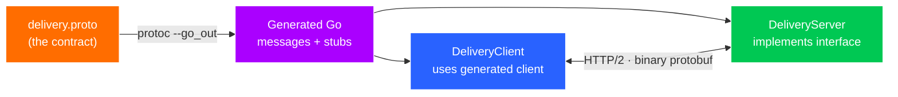

# Exercise 07 (Go) — gRPC: Unary, Server Streaming & Client Streaming

**Port:** 9090  **You'll learn:** contract-first APIs with protobuf, generated stubs, unary vs streaming RPCs, gRPC status codes & context deadlines

---

## The Story
Inside QuickBite, the **Order service** asks the **Delivery service** *"when will the rider arrive?"* thousands of times per second. Nobody reads these calls in a browser, so human-friendly JSON is unnecessary. We want: tiny messages, a strict contract, generated client stubs, and streaming capabilities. That's gRPC — Protocol Buffers over HTTP/2.



---

## How gRPC Works — Core Concepts

### 1. Contract-First API with Protobuf
Unlike REST where schemas are often an afterthought (or documented in OpenAPI), gRPC is strictly **contract-first**:
* You define your data structures and service methods in a `.proto` file (`delivery.proto`).
* In Protobuf, fields use **field numbers** (`order_id = 1`, `minutes = 2`), not string names on the wire.
* The protobuf compiler (`protoc`, using `protoc-gen-go` and `protoc-gen-go-grpc`) generates the Go structs and client/server interfaces (`delivery.pb.go`, `delivery_grpc.pb.go`). You never write manual JSON serializing or deserializing code.

### 2. Binary Wire Format vs JSON
* **JSON**: Serializes keys and values as human-readable ASCII text (`{"order_id":"ord_1","minutes":10,"rider_name":"Ravi"}`). Delimiters, colons, quotes, and repetitive key names consume ~51 bytes.
* **Protobuf**: Serializes keys as compact binary tags (1 byte encoding `field_number` and `wire_type`) and numbers as variable-length binary integers (varints). The identical payload takes only **15 bytes** (over 70% smaller).

### 3. The 3 RPC Patterns Implemented

| RPC | Signature | Real-world Use Case |
|---|---|---|
| `GetEta` | `EtaRequest` $\to$ `EtaReply` (**Unary**) | Synchronous function call between services. |
| `TrackRider` | `TrackRequest` $\to$ `stream RiderLocation` (**Server Streaming**) | Real-time GPS location telemetry pushed to client. |
| `UploadRoute` | `stream RiderLocation` $\to$ `RouteSummary` (**Client Streaming**) | Mobile rider app batching GPS points during trip. |

### 4. Deadlines & Cancellation in Go
* In microservice architectures ($A \to B \to C$), if downstream service $C$ freezes without a deadline, upstream services block waiting, exhausting goroutines and connections across the entire cluster (**cascading outage**).
* In Go, every gRPC call carries a `context.Context`:
  ```go
  ctx, cancel := context.WithTimeout(context.Background(), 2*time.Second)
  defer cancel()
  reply, err := client.GetEta(ctx, req)
  ```
* gRPC automatically propagates the remaining timeout down the call stack via the `grpc-timeout` HTTP/2 header. If the deadline expires, the call aborts with `codes.DeadlineExceeded`. The server detects cancellation via `stream.Context().Err()` and immediately stops wasted compute.

---

## Think & Answer (Interview Questions)

### 1. Protobuf put the reply in 15 bytes, JSON in 51. Where did the savings come from?
* **Field numbers instead of string keys**: JSON transmits field keys in full ASCII on every message (`"order_id"`, `"minutes"`, `"rider_name"` plus quotes, colons, and punctuation). Protobuf replaces field names with compact 1-byte tags encoding `(field_number << 3) | wire_type`.
* **Varints & Binary encoding**: Integers and timestamps are packed into binary varints (e.g. small integers take 1 byte instead of 4–10 ASCII characters).
* **No whitespace or delimiters**: Protobuf has no commas, curly braces, quotes, or spacing overhead.

### 2. Schema Evolution: Adding field 4 vs renumbering `minutes` from 2 to 5
* **Adding `string rider_phone = 4;`**: Safe and backward/forward compatible. Old clients that do not know field 4 simply ignore unknown field tags and deserialize fields 1, 2, and 3 without error. New clients parse field 4 normally.
* **Renumbering `minutes` from 2 to 5**: **Breaking change!** In Protobuf, the field number is the true identifier on the wire, not the variable name. Old clients expecting field 2 will find it missing (defaulting to 0) and will fail to read `minutes`. **Golden rule**: Never change or reassign an existing field number once deployed.

### 3. Why can't a browser call this gRPC server directly? What is gRPC-Web?
* Standard gRPC requires direct control over HTTP/2 transport framing — specifically **HTTP/2 trailers** (where gRPC passes `grpc-status` and error messages after the response body) and raw binary framing. Browser JavaScript fetch/XHR APIs do not expose low-level HTTP/2 frame control or streaming trailers.
* **gRPC-Web / Gateway**: An intermediary proxy (such as Envoy or grpc-gateway) translates browser-compatible HTTP/1.1 or standard HTTP/2 requests (which encode trailers in a custom framing or base64 stream) into standard gRPC HTTP/2 calls for backend services.

### 4. Why should every gRPC call carry a deadline? Cascading failures explained
* Without deadlines, if downstream service $C$ hangs (e.g., due to a database deadlock or memory freeze), upstream service $B$ blocks waiting on $C$, and service $A$ blocks waiting on $B$. Threads, sockets, and memory are rapidly exhausted across all services, causing a full cluster crash (**cascading outage**).
* gRPC propagates deadlines down the call tree via the `grpc-timeout` metadata header. If the deadline expires, the calls abort immediately, free up threads/resources, and return `codes.DeadlineExceeded`.

### 5. gRPC to HTTP status code mapping
| gRPC Status Code | HTTP Status Code | Meaning / Typical Scenario |
|---|---|---|
| `codes.NotFound` | `404 Not Found` | Requested entity (order, rider) does not exist |
| `codes.InvalidArgument` | `400 Bad Request` | Client passed invalid parameters (e.g., negative minutes) |
| `codes.Unauthenticated` | `401 Unauthorized` | Missing, expired, or invalid authentication token |
| `codes.PermissionDenied` | `403 Forbidden` | Authenticated caller lacks permissions (RBAC / ACL) |
| `codes.Unavailable` | `503 Service Unavailable` | Server overloaded, shutting down, or transient network blip |
| `codes.DeadlineExceeded` | `504 Gateway Timeout` | Operation exceeded allotted deadline before completing |

### 6. L4 vs L7 Load Balancing with HTTP/2 Multiplexing
* In HTTP/1.1, clients create and tear down many TCP connections, allowing an L4 (TCP-level) load balancer to distribute connections evenly across backend pods.
* In HTTP/2 / gRPC, a client opens **one single long-lived TCP connection** and multiplexes thousands of RPC calls over it.
* **The problem with L4 LB**: An L4 balancer only balances at TCP connection setup. All requests from a client will stay glued to that single server pod indefinitely, causing massive load imbalance (one pod at 100% CPU while others sit at 0%).
* **Solutions**:
  1. **L7 Proxy (Envoy, NGINX)**: Decodes HTTP/2 streams and load balances individual RPC requests to backends.
  2. **Client-side Load Balancing**: The gRPC client resolves multiple backend pod IPs (via DNS / headless service) and balances RPC calls across connection pools internally.

### 7. When to pick gRPC over REST (and when NOT to)
* **Pick gRPC when**:
  * High-throughput internal microservice-to-microservice (East-West) communication.
  * Streaming is needed (server push, client telemetry streaming, bidirectional).
  * Polyglot microservices where generated client stubs prevent contract drift.
  * Low latency, high CPU efficiency, and minimal network serialization overhead are critical.
* **Pick REST when**:
  * Public-facing APIs (North-South) consumed by external developers, third parties, and web browsers.
  * API needs to leverage HTTP caching (CDNs, browser caches via `Cache-Control`).
  * Human readability and easy debugging with standard tooling (`curl`, Postman, standard browser dev tools) are prioritized.

---

## How to Run

### 1. Start Server
```bash
go run ./07-grpc/server/main.go
```
Listening on `localhost:9090` (HTTP/2, Protobuf).

### 2. Run Client (in another terminal)
```bash
go run ./07-grpc/client/main.go
```

Expected Output:
```text
=== 1. Unary: GetEta ===
Ravi arrives in 10 min
wire size: protobuf 15 bytes vs JSON 51 bytes
ord_999 -> NotFound: No trip for ord_999

=== 2. Server streaming: TrackRider ===
  2400 m left  (12.9352, 77.6245)
  1920 m left  (12.9356, 77.6249)
  1440 m left  (12.9360, 77.6253)
   960 m left  (12.9364, 77.6257)
   480 m left  (12.9368, 77.6261)
     0 m left  (12.9372, 77.6265)
  ord_2 stream ended with DeadlineExceeded (deadline hit mid-stream)

=== 3. Client streaming: UploadRoute (stretch) ===
  server says: 5 points, 2.37 km
```

### 3. Run Automated Tests
```bash
go test -v ./07-grpc/...
```
