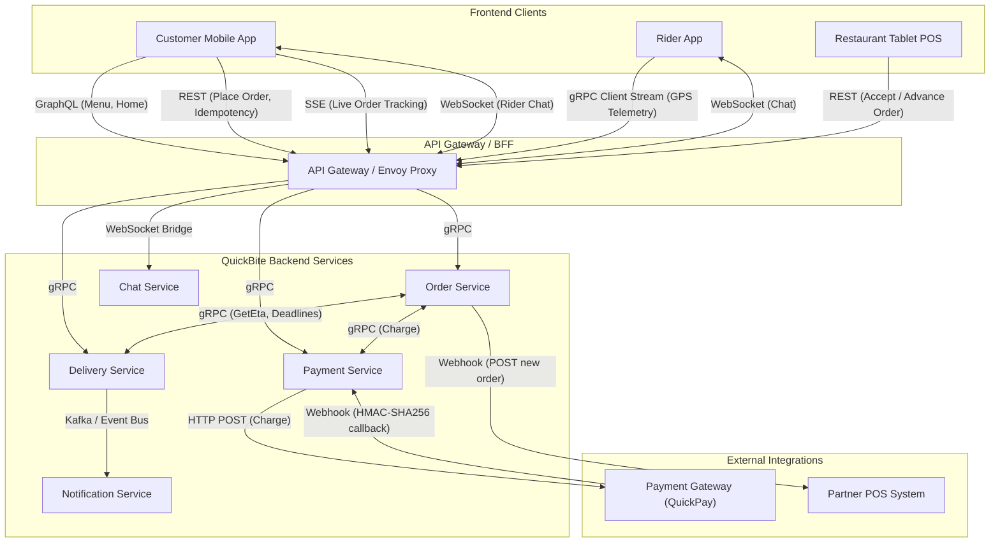

# Exercise 08 — Capstone: System Design & API Selection Guide

In high-level system design interviews, nobody asks you to write byte-level socket masking from memory. They ask:
> *"How does the customer app learn the delivery rider moved?"*
> *"How does our microservice architecture handle 20,000 calls/second without cascading outages?"*

This capstone pulls together the architectural tradeoffs learned throughout exercises 01–07.

---

## Part A — The Master API Comparison Table

| Attribute | REST | Short Poll | Long Poll | SSE | WebSocket | Webhook | GraphQL | gRPC |
|---|---|---|---|---|---|---|---|---|
| **Initiator** | Client | Client | Client | Client connects, Server streams | Client connects, Bi-directional | Server (Caller) | Client | Client |
| **Data Direction** | Request $\to$ Response | Request $\to$ Response | Request $\to$ Response | Server $\to$ Client (Unidirectional) | Full Duplex ($\leftrightarrow$) | Server $\to$ Server (Push) | Request $\to$ Response | Unary / Server / Client / Bidi |
| **Connection Model** | New TCP per call (or HTTP keep-alive) | Repeated short TCP/HTTP calls | Held open until news or timeout | Single long-lived HTTP connection | Single persistent upgraded TCP connection | New HTTP call per event | Single HTTP POST | Single multiplexed HTTP/2 connection |
| **Wire Format** | JSON / XML (Text) | JSON (Text) | JSON (Text) | UTF-8 plain text (`event-stream`) | Binary frames (Text / Binary payload) | JSON (Text) | JSON (Text) | Protocol Buffers (Binary) |
| **Browser Support** | Native (`fetch`) | Native (`setInterval`) | Native (`fetch` loop) | Native (`EventSource`) | Native (`WebSocket`) | N/A (Server-to-Server) | Native (`fetch` POST) | Requires gRPC-Web / Proxy |
| **Hardest Scaling Bottleneck** | Server CPU parsing JSON & SSL handshakes | Wasted requests & high DB polling query load | Connection pool & thread exhaustion | Thousands of open HTTP connections | Stateful TCP connections & sticky load balancers | Destination downtime & backoff queue backpressure | Complex nested queries & N+1 resolver queries | L4 vs L7 load balancing over HTTP/2 |
| **Real Product Example** | GitHub REST API, Stripe API | Flight price checkers, package trackers | Gmail chat (early), Web chat fallbacks | ChatGPT token streaming, Twitter feeds | Slack, Discord, TradingView live charts | Stripe payment callbacks, GitHub webhooks | GitHub GraphQL API, Shopify Storefront | Google / Netflix internal microservices |

---

## Part B — 14 Architectural Scenarios (Interview Practice)

### 1. Food-delivery order status tracking for 30 minutes
* **Pick**: **Server-Sent Events (SSE)** (or Long Polling as fallback).
* **Why**: The flow of data is purely unidirectional (server $\to$ client). SSE includes native browser auto-reconnect and `Last-Event-ID` out of the box with zero third-party dependencies.
* **Failure Mode**: Mobile device switches between Wi-Fi and 5G; connection drops. Mitigated by `Last-Event-ID` event replay.

### 2. Trading dashboard: 50 price updates/sec across 20 stocks (Read-only)
* **Pick**: **WebSocket** (or binary SSE).
* **Why**: At 50 updates/sec, standard HTTP header overhead ($\approx 1\text{ KB}$ per request) crushes bandwidth. WebSocket frames carry only 2–10 bytes of framing overhead per packet.
* **Failure Mode**: Client lag causes TCP backpressure on the server. Mitigated by conflating/throttling ticker updates per client.

### 3. Live multiplayer quiz game: 500 players answering questions with instant leaderboard
* **Pick**: **WebSocket**.
* **Why**: True bidirectional, low-latency interaction: clients submit answers simultaneously and receive sub-100ms score updates.
* **Failure Mode**: Network spikes on question close cause a "thundering herd" of incoming answers. Mitigated by queuing answers in memory (Redis/Kafka).

### 4. Payment gateway notifying merchant of completed refund (3 days later)
* **Pick**: **Webhook**.
* **Why**: Asynchronous server-to-server event with indefinite delay. Client connections cannot remain open across days.
* **Failure Mode**: Merchant server is down or returning 500s. Mitigated by exponential backoff retries and dead-letter queues (DLQ).

### 5. "Export all orders as CSV" taking ~10 minutes to generate
* **Pick**: **Asynchronous REST + Polling or Webhook / Email**.
* **Why**: Long-running background jobs must not block HTTP requests (`202 Accepted` returning a `job_id`).
* **Failure Mode**: Client closes tab during export. Mitigated by saving the generated CSV to S3 and emailing a signed download link.

### 6. Payments service calling fraud-check service 20,000 times/sec with 50ms budget
* **Pick**: **gRPC (Unary with HTTP/2)**.
* **Why**: Binary Protobuf serialization reduces CPU and network payload size by >70%, while HTTP/2 multiplexes calls over persistent TCP pools.
* **Failure Mode**: Downstream fraud service latency spikes. Mitigated by strictly enforced gRPC deadlines (`context.WithTimeout`).

### 7. Android, iOS, and Web home screens each requiring different fields
* **Pick**: **GraphQL**.
* **Why**: Eliminates over-fetching on mobile (battery/data savings) and under-fetching (no multiple round-trips).
* **Failure Mode**: Malicious or unoptimized deeply nested queries cause server crashes. Mitigated by query depth limiting and persisted queries (APQ).

### 8. Partner restaurants integrating external POS systems to update menus
* **Pick**: **REST API**.
* **Why**: Universal industry standard with standard HTTP tooling (`curl`, Postman, OpenAPI/Swagger).
* **Failure Mode**: Partner POS systems sending duplicate updates. Mitigated by requiring `Idempotency-Key` headers.

### 9. AI chatbot streaming token-by-token generation into the browser
* **Pick**: **Server-Sent Events (SSE)**.
* **Why**: Text is generated incrementally and pushed one-way. SSE operates over standard HTTP/1.1 or HTTP/2 without WebSocket handshake complexity.
* **Failure Mode**: Corporate proxies buffer responses until connection closes. Mitigated by sending keep-alive heartbeat comments and disabling proxy buffering (`X-Accel-Buffering: no`).

### 10. Real-time collaborative document editing with live cursors
* **Pick**: **WebSocket**.
* **Why**: Continuous, bidirectional micro-payloads (cursor coordinates, operational transformation/CRDT deltas) require full duplex pipes.
* **Failure Mode**: Out-of-order state merges. Mitigated by CRDTs (Conflict-free Replicated Data Types) or vector clocks.

### 11. CI/CD system notifying Slack channel when a build fails
* **Pick**: **Incoming Webhook**.
* **Why**: Event-driven notification between external third-party systems. Simple HTTP POST with JSON payload.
* **Failure Mode**: Slack rate limiting (HTTP 429). Mitigated by client-side rate limiters with retry-after backoff.

### 12. Rider app transmitting GPS coordinates every 2 seconds during delivery
* **Pick**: **gRPC Client-Streaming** (or HTTP/2 batching).
* **Why**: High-frequency telemetry stream from mobile app directly to delivery backend, saving TCP connection setup overhead.
* **Failure Mode**: Rider enters an underground tunnel or dead zone. Mitigated by local SQLite buffering on device and batch uploading upon reconnect.

### 13. CLI script waiting for GitHub Pull Request checks to finish before merging
* **Pick**: **Short Polling with Exponential Backoff**.
* **Why**: Simple CLI tool without long-lived server infrastructure. Polling every 15–30 seconds uses minimal resources.
* **Failure Mode**: Hitting GitHub API rate limits. Mitigated by honoring `Retry-After` and `X-RateLimit-Reset` headers.

### 14. Browser notification counter ("3 new messages") behind strict 30s timeout corporate proxies
* **Pick**: **Long Polling (with 25s timeout)**.
* **Why**: Proxies kill connections open > 30s. A 25s long-poll answers within the proxy window or returns `204 No Content`, prompting a fresh connection.
* **Failure Mode**: Increased connection churn. Mitigated by reusing HTTP/2 or HTTP keep-alive connections.

---

## Part C — QuickBite End-to-End System Architecture

### Architectural Deep-Dive Questions

1. **Which arrow is the hardest to scale to 1M concurrent users, and why?**
   * **The WebSocket Chat and Live GPS Tracking arrows**.
   * *Why*: REST and GraphQL are stateless; an auto-scaler can spin up 100 pods and distribute requests with any standard load balancer. WebSockets and streaming hold stateful, long-lived TCP connections pinned to specific server instances. Scaling requires an external pub/sub backbone (e.g. Redis Pub/Sub, Kafka, or NATS) and custom sticky session routing.

2. **Where would you put an API Gateway / BFF (Backend-For-Frontend), and what does it do?**
   * Sits at the network boundary between public clients and private microservices (e.g. Envoy, Kong, or custom Go BFF).
   * *Responsibilities*:
     1. **Protocol Translation**: Terminates HTTP/1.1, WebSocket, and GraphQL from browsers, and translates to internal high-speed gRPC.
     2. **Cross-Cutting Concerns**: Rate limiting, JWT authentication/authorization, SSL/TLS termination, request correlation ID tracing.
     3. **Resilience**: Enforces request timeouts and circuit breaking.

3. **Pick one arrow and describe its failure mode and retry/idempotency strategy:**
   * **`Customer App -> Order Service` (`POST /orders`)**:
     * *Failure Mode*: User submits order on flaky 4G. Network drops after the order is created on server but before the confirmation response reaches the phone. User hits "Submit" again.
     * *Strategy*: Client generates a UUID `Idempotency-Key` before sending. The server checks Redis with `SETNX order_id idempotency_key`. If present, it skips payment/order creation and safely replays the cached `200 OK` response with `Idempotent-Replayed: true`.

---

## Part D — 60-Second Interview Pitches

### 1. "WebSocket vs SSE — when would you choose SSE?"
> *"I pick SSE whenever the communication is purely one-way from server to client, such as real-time notifications, stock tickers, or AI token streaming. SSE runs over plain HTTP, works out of the box with native browser `EventSource`, handles automatic reconnections and message replay via `Last-Event-ID`, and bypasses strict corporate firewalls without special proxy configuration. I only reach for WebSockets when I need true full-duplex bidirectional streaming, like gaming, chat, or collaborative editing."*

### 2. "Why not just poll?"
> *"Short polling wastes bandwidth, server CPU, and database query capacity because 95% of requests return 'no change'. It also introduces unavoidable latency—the UI is always stale by half the polling interval. However, polling is completely appropriate when updates happen infrequently, when building simple CLI tools, or when implementing long-polling as a fallback behind strict corporate proxies that kill open TCP connections."*

### 3. "How do you make a webhook receiver safe?"
> *"Three critical pillars: First, **authenticity**: verify the HMAC-SHA256 signature using the raw request body bytes and constant-time comparison to prevent timing attacks. Second, **replay protection**: include a signed timestamp in the header and reject requests older than 5 minutes. Third, **idempotency**: gateways retry on transient failures, so store the unique event ID in an ACID database or distributed lock to ensure duplicate events are safely acknowledged with HTTP 200 without executing side effects twice."*

### 4. "When is GraphQL a bad idea?"
> *"GraphQL is a poor fit for public-facing third-party developer APIs, simple CRUD services, or file uploads. Because all queries hit a single POST endpoint with dynamic payloads, standard HTTP edge caching (CDNs) becomes complex. Additionally, without strict query complexity analysis, depth limiting, and DataLoaders, clients can inadvertently trigger devastating N+1 database queries that take down production."*

### 5. "Why do companies use gRPC internally but REST externally?"
> *"Internally (East-West traffic), microservices need maximum throughput, minimal serialization overhead, and strict type safety across polyglot teams. gRPC's binary Protobuf format cuts wire payloads by >70% and multiplexes thousands of calls over a single HTTP/2 TCP connection. Externally (North-South traffic), REST over JSON remains king because it is human-readable, requires zero generated client stubs, works seamlessly in every web browser, and leverages standard CDN edge caching."*

