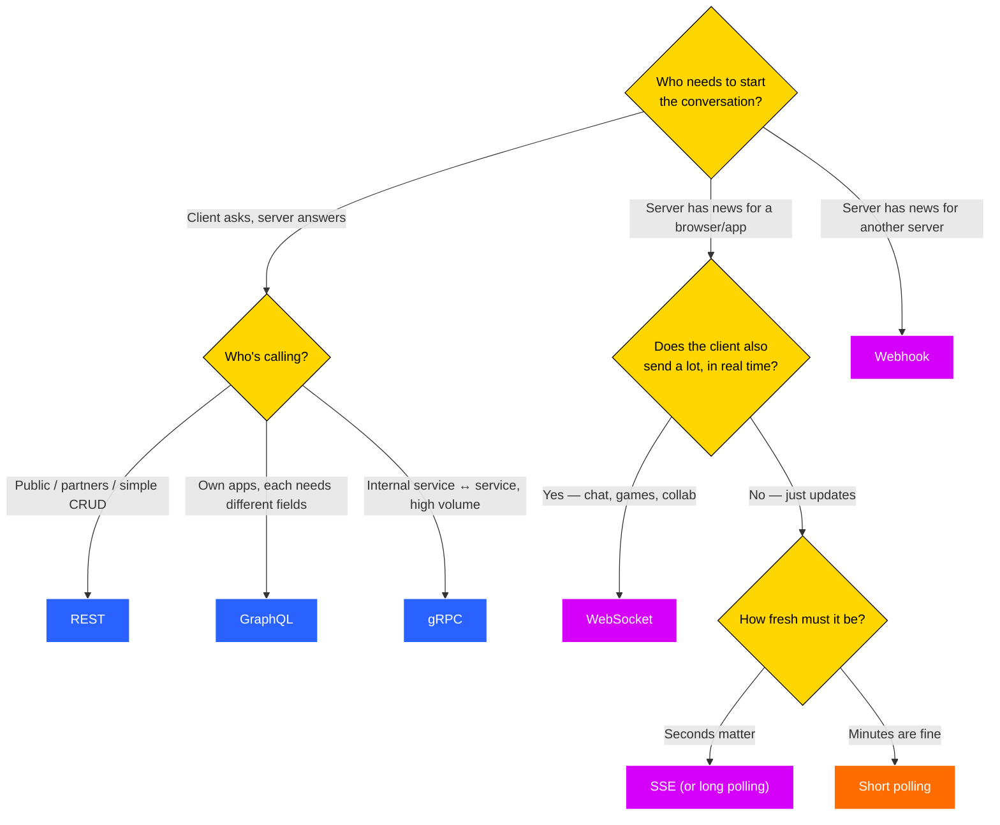

# API Design Lab (Go Edition) — Build Every Way Two Programs Can Talk

Eight hands-on exercises. One continuous story throughout: **QuickBite**, a real-world food-delivery application.

Each exercise takes one concrete engineering challenge in that app and solves it using the API paradigm that fits it best — so by the end you don't just know *what* REST, polling, SSE, WebSockets, webhooks, GraphQL, and gRPC are, you've *felt* why each one exists and how to implement it cleanly in Go.

---

## The Decision Tree: How to Pick the Right API



---

## Exercises Map

| # | Folder | Problem in QuickBite | Paradigm | Implementation Highlights | Port | Time |
|---|---|---|---|---|---|---|
| **01** | [`01-rest`](./01-rest/) | Place / view / list / cancel orders | **REST** | Standard `net/http`, `Idempotency-Key` caching, pagination, `PATCH` vs `DELETE`, `409 Conflict` | `8081` | 60 min |
| **02** | [`02-polling`](./02-polling/) | "Where's my order?" tracker | **Short vs Long Polling** | `select` timeouts, goroutines & channel notifications, latency scorecard | `8082` | 45 min |
| **03** | [`03-sse`](./03-sse/) | Same tracker, server pushes | **Server-Sent Events** | `http.Flusher`, `Last-Event-ID` auto-replay, `204 No Content` stop, live HTML5 UI | `8083` | 40 min |
| **04** | [`04-websockets`](./04-websockets/) | Rider ⇄ Customer live chat | **WebSockets** (from raw TCP sockets!) | RFC 6455 framing, SHA-1 GUID handshake, client XOR masking, chat hub | `8084` | 60 min |
| **05** | [`05-webhooks`](./05-webhooks/) | Payment gateway tells us "paid" | **Webhooks** | HMAC-SHA256 signatures, constant-time `hmac.Equal`, 5-min replay window, exponential backoff | `8091` / `8092` | 60 min |
| **06** | [`06-graphql`](./06-graphql/) | Home screen needs exactly these fields | **GraphQL** | `graphql-go`, nested resolvers, N+1 query tracking, interactive playground | `8086` | 60 min |
| **07** | [`07-grpc`](./07-grpc/) | Order service asks delivery service for ETA | **gRPC** | Unary, server-streaming, client-streaming RPCs, wire size savings vs JSON, context deadlines | `9090` | 60 min |
| **08** | [`08-capstone`](./08-capstone/) | Which one, when? | **Design Worksheet & Scenarios** | Master comparison matrix, 14 real-world interview scenarios, QuickBite end-to-end diagram | — | 45 min |

---

## Ports Reference

| Port | Service / Exercise | Protocol | Description |
|---|---|---|---|
| **8081** | Order API (`01-rest`) | HTTP/1.1 REST | Menu, orders, idempotency, pagination |
| **8082** | Tracking Server (`02-polling`) | HTTP/1.1 Polling | Short vs long polling comparison |
| **8083** | Live Tracker (`03-sse`) | Server-Sent Events | `text/event-stream` push with EventSource |
| **8084** | Chat Server (`04-websockets`) | WebSocket (RFC 6455) | Full-duplex messaging from raw TCP sockets |
| **8086** | GraphQL API (`06-graphql`) | GraphQL over HTTP | Single endpoint `/graphql` + Playground |
| **8091** | QuickPay Gateway (`05-webhooks`) | HTTP/1.1 REST & Webhook | Mock payment gateway with retries |
| **8092** | QuickBite Merchant (`05-webhooks`) | HTTP/1.1 REST & Receiver | Webhook verification endpoint |
| **9090** | Delivery Service (`07-grpc`) | gRPC over HTTP/2 | High-throughput binary protobuf RPC |

*(If a port is busy, stop the earlier exercise's server using `Ctrl+C`).*

---

## Setup & Prerequisites

* **Go 1.25+** (`go version`). Built with idiomatic Go standard library and modern routing patterns.
* `curl` (built into macOS, Linux, and Windows 10+).
* A modern web browser (for testing SSE, WebSockets, and GraphQL playgrounds).

---

## How Every Exercise Works

1. **Read the folder's `README.md`**: Each folder includes the background story, architecture diagrams, key concepts, and extensive **Think & Answer** interview questions with answers.
2. **Run the server**: Every implementation is clean and ready to run with `go run ...`.
3. **Run the automated test suite**: Each exercise comes with unit tests verifying full behavior:
   ```bash
   go test -v ./...
   ```
4. **Inspect the Think & Answer section**: Read through the detailed interview questions explaining the architectural trade-offs, security practices, and scaling failure modes.

---

## Quick Start: Running Individual Exercises

### Exercise 01: REST API
```bash
go run ./01-rest/main.go
# Server runs on http://localhost:8081
# Run tests: go test -v ./01-rest/...
```

### Exercise 02: Short vs Long Polling
```bash
# Terminal 1: Start tracking server
go run ./02-polling/server/main.go

# Terminal 2: Run polling client
go run ./02-polling/client/main.go short 2000
# Or test long polling:
go run ./02-polling/client/main.go long
```

### Exercise 03: Server-Sent Events (SSE)
```bash
go run ./03-sse/main.go
# Open http://localhost:8083 in your browser to test live order tracking and auto-reconnect
```

### Exercise 04: WebSockets From Scratch
```bash
# Terminal 1: Start raw socket WebSocket server
go run ./04-websockets/server/main.go

# Terminal 2: Test via browser on http://localhost:8084 or run the CLI client:
go run ./04-websockets/client/main.go Rider_Ravi ord_42
```

### Exercise 05: Webhooks (Security & Retries)
```bash
# Terminal 1: Start QuickPay Gateway (port 8091)
go run ./05-webhooks/gateway/main.go

# Terminal 2: Start QuickBite Merchant App (port 8092)
go run ./05-webhooks/merchant/main.go

# Place an order and watch the asynchronous webhook arrive:
curl -X POST http://localhost:8092/orders -H "Content-Type: application/json" -d '{"amount":499}'
```

### Exercise 06: GraphQL (Playground & Resolvers)
```bash
go run ./06-graphql/main.go
# Open the interactive GraphQL Playground on http://localhost:8086
```

### Exercise 07: gRPC (Unary & Streaming)
```bash
# Terminal 1: Start gRPC server (port 9090)
go run ./07-grpc/server/main.go

# Terminal 2: Run gRPC client
go run ./07-grpc/client/main.go
```

### Exercise 08: Capstone System Design
Explore [`08-capstone/README.md`](./08-capstone/) for the complete master comparison matrix, the 14 real-world interview scenarios, and the end-to-end architecture diagram.

---

## Run All Unit Tests in One Command

To verify that all 7 exercises pass their automated test suites:

```bash
go test ./...
```
