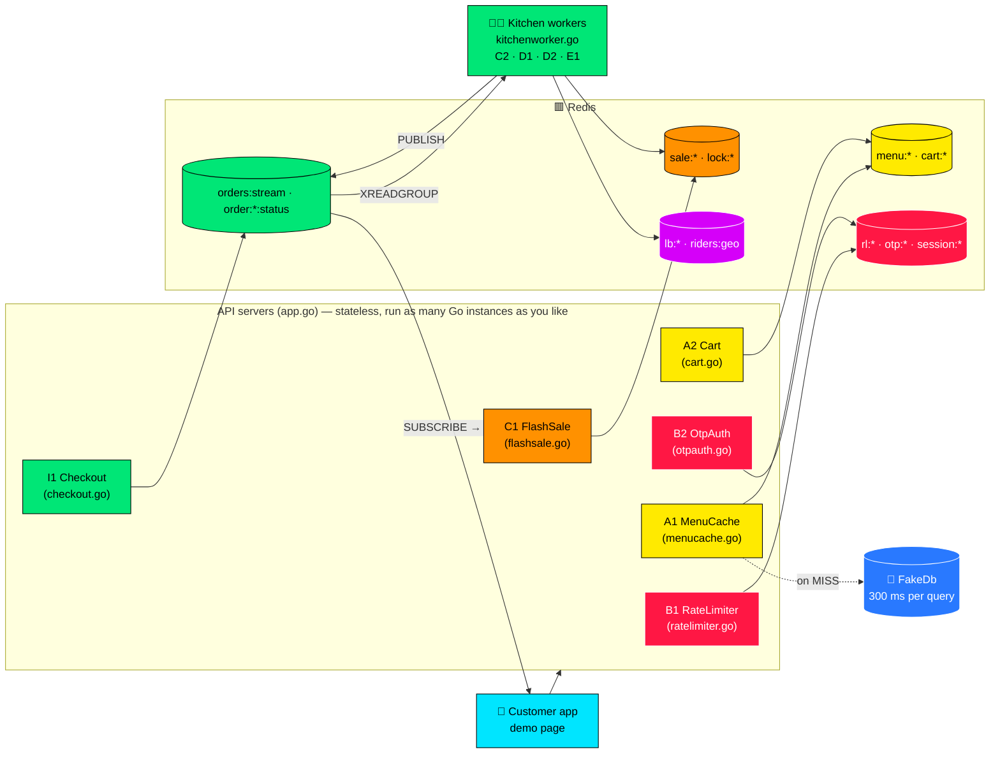
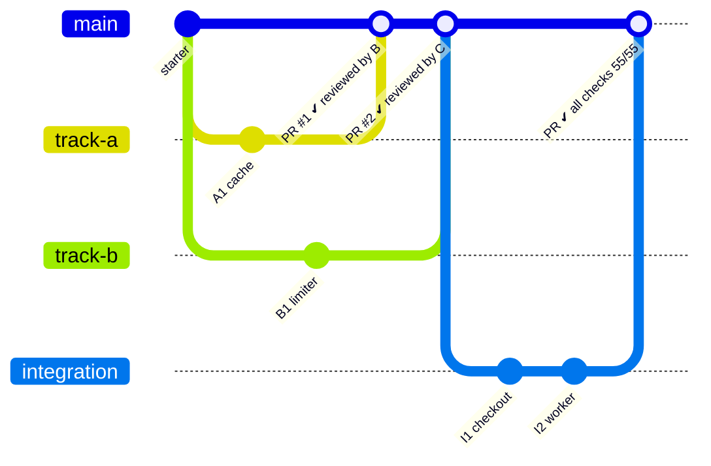

# Assignment 2 — QuickBite on Redis 🟥 (Go Edition)

You've built QuickBite's APIs in Go. Now it has a million users, and Postgres is on fire.
Your team will add **10 features to QuickBite, each built on a different Redis data structure** — the exact patterns Swiggy, Zomato, Uber, Stripe, and modern Go microservices run on Redis in production.

By the end, every member can answer the system-design interview question *"Where would you use Redis here, which data structure, and how do you ensure safety across distributed Go services?"* — because you've built each answer.

| # | Feature | Redis structure | The pattern you'll be able to explain in an interview |
|---|---|---|---|
| A1 | Menu cache | `STRING` + TTL | Cache-aside, cache invalidation, TTL jitter, cache stampede (and Go `singleflight`) |
| A2 | Shopping cart | `HASH` | Per-field atomic updates, sliding expiration |
| B1 | Rate limiter | `INCR` counter · `ZSET` | Fixed vs sliding window, atomicity across API instances with Lua |
| B2 | OTP login + sessions | `STRING` + TTL · `HASH` | Expiring codes, brute-force lockout, shared distributed sessions |
| C1 | ₹1 flash sale | Counter + `SET` + **Lua** | Check-then-act race conditions, why `sync.Mutex` fails across multiple servers, atomic Lua execution |
| C2 | Rider assignment lock | `SET NX PX` + Lua | Distributed locks, safe compare-and-delete unlock, lock expiry watchdog |
| D1 | Top restaurants this week | `ZSET` | Real-time leaderboards, O(log N) ranks without SQL table scans |
| D2 | Riders near me | `GEO` | Geospatial radius search (geohash), heartbeats, lazy index cleanup |
| E1 | Live order status | **Pub/Sub** | Real-time event fan-out across Go servers (multi-server SSE bridge) |
| E2 | Order queue | **Streams** + consumer group | Reliable at-least-once queues, consumer groups, worker acks, crash recovery |

---

## The System Architecture



---

## Your Team: 4–5 People, One Track Each

| Track | Owner | Files you own | Spec | Feel |
|---|---|---|---|---|
| 🟨 **A — Speed** | member 1 | `menucache.go`, `cart.go` | [docs/TRACK-A.md](docs/TRACK-A.md) | Easiest start; most-used caching patterns in the industry |
| 🟥 **B — Protection** | member 2 | `ratelimiter.go`, `otpauth.go` | [docs/TRACK-B.md](docs/TRACK-B.md) | Distributed rate limiting & your first Lua script |
| 🟧 **C — Correctness** | member 3 | `flashsale.go`, `riderlock.go` | [docs/TRACK-C.md](docs/TRACK-C.md) | Concurrency & race conditions; the checker fires 400 goroutines |
| 🟪 **D — Real-time data** | member 4 | `leaderboard.go`, `nearbyriders.go` | [docs/TRACK-D.md](docs/TRACK-D.md) | Sorted sets and geospatial indexing, very visual |
| 🟩 **E — Events + glue** | member 5 *or everyone* | `liveupdates.go`, `orderpipeline.go`, `checkout.go`, `kitchenworker.go` | [docs/TRACK-E.md](docs/TRACK-E.md) | Pub/Sub, Streams, and wiring everyone's Go components together |

* **Team of 4?** Split E1/E2 between two members in week 1, and write `Checkout` + `KitchenWorker.ProcessOrder` together in week 2 (pair programming).
* **Everyone** answers [docs/DESIGN.md](docs/DESIGN.md) together and keeps [docs/KEYS.md](docs/KEYS.md) up to date.
* Each feature lives in its own file, so team members can work in parallel without merge conflicts. Nobody needs to edit `app.go`, `redis.go`, `fakedb.go`, or `demopage.go`.

---

## Setup & Prerequisites (20 minutes)

1. **Go 1.25+** — check with `go version`. The project uses standard library Go with zero external package dependencies!
2. **Redis 7** — easiest via Docker:
   ```bash
   docker compose up -d
   # Redis runs on localhost:6379
   # RedisInsight (GUI) runs on http://localhost:5540
   docker compose exec redis redis-cli ping      # -> PONG
   ```
   *No Docker?*
   * **macOS:** `brew install redis && redis-server`
   * **Linux:** `sudo apt install redis-server && sudo systemctl start redis`
   * **Windows:** Use WSL2 (`sudo apt install redis-server`) or a free [Redis Cloud](https://redis.io/try-free/) instance (set `REDIS_HOST`, `REDIS_PORT`, `REDIS_PASSWORD`).
3. **Run the checker** — initially, all tests will fail with `TODO(n) not implemented yet`. That's your to-do list:
   ```bash
   ./run.sh check          # or: go run . check all
   ./run.sh check A        # just your track
   ```
4. **Run the app** — `./run.sh` (or `go run .`), then open **http://localhost:8080**.
   Each card on the demo dashboard corresponds to one feature and starts functioning the moment you complete its TODOs.

> [!TIP]
> Keep `redis-cli MONITOR` open in a separate terminal while you develop. You will see every raw Redis command your Go code issues in real time — the fastest way to debug!

---

## How Go Talks to Redis (The RESP Protocol)

There are no heavy third-party dependencies required. `redis.go` is a lightweight, zero-dependency client that implements the Redis Serialization Protocol (RESP2) with built-in connection pooling, pub/sub, and Lua evaluation.

You send the **exact same commands you would type in `redis-cli`**:

```go
// 1. Write / String
RedisCall("SET", "menu:r1", jsonBytes, "EX", 60)               // -> "OK"

// 2. Read string
v, err := RedisStr("GET", "menu:r1")                           // -> string or ""

// 3. Counter
n, err := RedisNum("INCR", "rl:fixed:u1:29812345")             // -> int64

// 4. Sorted sets / lists
top, err := RedisList("ZREVRANGE", "lb:restaurants:2026-W47", 0, 9, "WITHSCORES")

// 5. Atomic Lua scripts
res, err := RedisEval(luaScript, []string{stockKey, buyersKey}, userID)
```

### Why we do this
By issuing raw commands rather than hiding behind high-level ORMs, you master **actual Redis commands and data structures**, which are universal across Go, Java, Python, Node.js, and C++. In production Go services, you would typically use libraries like [`go-redis/v9`](https://github.com/redis/go-redis) or [`rueidis`](https://github.com/redis/rueidis); the commands and options remain identical.

---

## Key Theory: Go Concurrency vs. Distributed Redis

When converting from single-process applications or traditional Java architectures to modern Go microservices, keep these architectural distinctions in mind:

### 1. `sync.Mutex` vs. Distributed Lock (`RiderLock`)
* In Go, `sync.Mutex` or `sync.RWMutex` synchronizes goroutines inside a **single Go runtime process**.
* In a production cloud environment, you run **multiple stateless Go API containers** behind an ALB / ingress. A local mutex cannot prevent two separate Go instances from dispatching the same rider simultaneously.
* **Redis distributed lock (`SET lock:{id} token NX PX`)** or Lua scripts enforce atomicity **across the entire cluster of Go servers**.

### 2. Goroutines vs. Virtual Threads
* In Go, goroutines are lightweight userspace green threads multiplexed onto OS threads by the Go runtime scheduler (M:N scheduler).
* The test checker fires **400 concurrent goroutines** against the flash sale and distributed lock endpoints. Without atomic Redis operations (Lua / `SET NX`), race conditions will instantly cause overselling.

### 3. Cache Stampede & Go's `singleflight`
* In Track A1, when a hot cache key expires, 100 incoming requests might simultaneously miss and stampede the database.
* In Go standard ecosystem, [`golang.org/x/sync/singleflight`](https://pkg.go.dev/golang.org/x/sync/singleflight) is the standard in-process deduplication tool. In this lab, you'll also explore the **distributed Redis mutex pattern** (`SET lock:menu:{id} 1 NX PX 2000`) which coordinates across all Go server nodes.

### 4. Background Workers with Context & Channels
* Go excels at long-running daemons. In `kitchenworker.go`, workers poll Redis Streams (`XREADGROUP`) and rescue stuck consumer entries (`XAUTOCLAIM`).
* Understanding at-least-once message delivery, crash recovery, and acknowledgement (`XACK`) is essential for building resilient event-driven Go systems.

---

## Working as a Team (Git Flow)



1. **One repository per group**. Create a branch per track: `track-a`, `track-b`, etc.
2. **Before you write code**, register your key patterns in [`docs/KEYS.md`](docs/KEYS.md) (name, type, TTL, and owner) and submit a PR. Key collisions are common bugs in distributed systems.
3. Every PR must be reviewed and approved by **someone from another track**. The reviewer runs `./run.sh check <track>` locally and leaves at least one constructive comment.
4. Keep a brief daily standup in your group: what was done, what's next, and any blockers.

---

## Suggested Timeline (2 Weeks)

| When | Milestone |
|---|---|
| Day 0 (Together) | Setup, verify Redis, inspect failing checks, fill `KEYS.md`, read track docs |
| Days 1–4 | Each member finishes their track: `./run.sh check <track>` passes green, PRs reviewed & merged |
| Days 5–7 | Track E glue (`checkout.go`, `kitchenworker.go`), full `./run.sh check` → **all tests passing** |
| Days 8–10 | Answer [`docs/DESIGN.md`](docs/DESIGN.md), attempt stretch goals, demo rehearsal |
| Demo Day | 15-minute live demo + Q&A |

---

## Deliverables

1. **Code:** `./run.sh check` passes with all tests green.
2. **`docs/KEYS.md`:** Every key pattern used with data type, TTL, and owner documented.
3. **`docs/DESIGN.md`:** Team answers to system design interview questions.
4. **Live Demo (15 min):**
   1. OTP login and token generation (`otp:*` and `session:*` keys visible in RedisInsight with TTLs).
   2. Menu cache-aside demonstration: MISS (≈300 ms) → HIT (≈1 ms). Invalidation on price update.
   3. Flash sale: compare naive (oversells) vs. atomic Lua script (exact inventory preserved).
   4. Rate limiter demo under load: fixed window vs. sliding window behavior.
   5. Kitchen worker stream processing: demonstrate order lifecycle and crash recovery (`--crash` worker rescued by active workers).
   6. Leaderboards and geospatial rider proximity search.
   7. Cross-explanation: team members explain components authored by peers.

---

## CLI Commands Reference

```bash
./run.sh                    # Start API server on http://localhost:8080 (or: go run . app)
./run.sh check [A-E|all]    # Run test suite (or: go run . check A)
./run.sh worker w1          # Start kitchen worker w1 (or: go run . worker w1)
./run.sh worker w9 --crash  # Starts worker that crashes without acknowledging (tests crash recovery)
redis-cli MONITOR           # Live stream of every Redis command
redis-cli --scan --pattern 'menu:*' # Scan keys safely (never use KEYS * in production)
```
