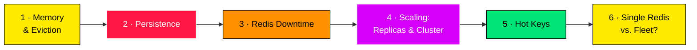

# Design Questions — Answer as a Team (Go Edition)

These are core high-level system design (HLD) interview questions about **the distributed QuickBite architecture you just built in Go**.

Each answer should be 5–10 lines and explicitly evaluate trade-offs. "It depends" is fine *if* you articulate on what factors it depends.

---

### 1. Memory and Eviction Policies
Using your estimate from `KEYS.md`, what is the minimum memory footprint required for Redis?
When Redis reaches its memory ceiling (`maxmemory`), compare the behavior of these eviction policies for **our** specific key mix:
* `noeviction`
* `allkeys-lru`
* `volatile-lru`

Which of our keys would be catastrophic to evict (user sessions? order queue stream? flash sale inventory counters?) versus keys that are completely safe to drop (read-through menu caches)? Which eviction policy would you select for QuickBite's production configuration, and why?

---

### 2. Persistence Trade-Offs (RDB vs. AOF)
Suppose the Redis process crashes or restarts unexpectedly:
* Which features lose critical business state that cannot be recovered, and which features can recover seamlessly?
* Compare **RDB point-in-time snapshots** (e.g. `save 60 1000`) and **AOF (Append-Only File)** with `appendfsync everysec`.
* Our `docker-compose.yml` activates AOF with `appendfsync everysec`. Can this configuration still lose up to 1 second of flash sale checkouts or orders in flight? How would you guarantee absolute durability for the order queue?

---

### 3. Redis Outage Resilience (Fail Open vs. Fail Closed)
Suppose Redis is completely unreachable for 2 minutes (network partition or primary failover). For **each** feature, what does the user experience today, and what architectural fallback *should* your Go API implement?

| Feature | What breaks in our code today | Resilient fallback strategy (Fail open / Fail closed / DB fallback) |
|---|---|---|
| Menu cache | DB query fallback or error? | |
| Shopping cart | Cart loss or temporary session cart? | |
| Rate limiter | Block all users or allow traffic? | |
| OTP / Auth | Reject logins or fallback to DB? | |
| ₹1 Flash sale | Strict fail closed or allow? | |
| Rider assignment lock | Allow concurrent dispatch or pause? | |
| Leaderboard | Fallback to yesterday's snapshot? | |
| Nearby riders | Full scan PostGIS or return empty? | |
| Live SSE status | Drop events or fall back to polling? | |
| Order queue stream | Write to Postgres inbox table or reject? | |

---

### 4. Horizontal Scaling: Replicas & Redis Cluster
a) **Read Replicas:** We attach 3 read replicas to handle high read volume. Which of our operations can safely read from an asynchronous replica (accepting eventual consistency / replication lag), and which must strictly hit the primary node?  
b) **Redis Cluster & Multi-Key Hashes:** In Redis Cluster, keys are sharded across 16,384 hash slots by CRC16. `BuyLua` in `flashsale.go` accesses both `sale:{id}:stock` and `sale:{id}:buyers` in the same Lua execution. Why does Redis Cluster return a `CROSSSLOT Keys in request don't hash to the same slot` error? Explain how **hash tags** (e.g. `sale:{biryani}:stock` and `sale:{biryani}:buyers`) solve this issue.  
c) Which other multi-key commands or Lua scripts in our Go codebase would trigger the same `CROSSSLOT` error in Redis Cluster?

---

### 5. Hot Key Mitigation
At 8:00 PM on Friday, 200,000 Go mobile clients simultaneously load Dosa Junction's menu within the same 60-second window. All reads target the single key `menu:r1`, which resides on **one** Redis node.
* What hardware/networking bottlenecks occur on that single Redis node?
* Propose two industry-standard mitigation strategies:
  1. Go in-memory caching (e.g. `singleflight` or local cache with short TTL).
  2. Key duplication with random read striping (e.g. `menu:r1:{0..9}`).

---

### 6. Single Redis Fleet vs. Dedicated Clusters
In this lab, we colocated read caches, user sessions, distributed rate limiters, locks, and the durable order queue inside a single Redis instance.
* Argue the case for decoupling these into separate, dedicated Redis clusters (or replacing the order stream with a specialized queue like Kafka or SQS).
* If you were tasked with splitting the Redis workload into two independent clusters tomorrow, which features would you isolate first, and why?

---

### 7. Redis vs. The Alternatives (One-Sentence Trade-Off)
* **Order queue:** Redis Streams vs. Apache Kafka vs. AWS SQS
* **User sessions:** Redis Server-Side Sessions vs. Client-Side JWTs
* **Geospatial rider proximity:** Redis GEO vs. Postgres / PostGIS vs. Elasticsearch
* **Distributed locking:** Redis (`SET NX PX` / Redlock) vs. etcd / Consul vs. Postgres row-level lock (`SELECT FOR UPDATE`)
