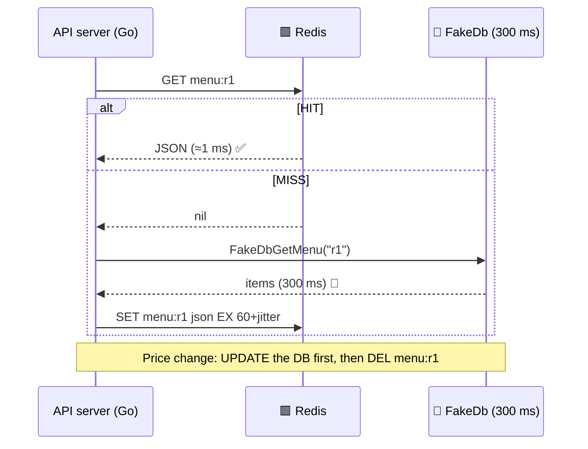

# 🟨 Track A — Speed: menu cache + cart (Go Edition)

**Files:** `menucache.go`, `cart.go`  **Check:** `./run.sh check A` (or `go run . check A`)  **Demo cards:** 2 (Menu), 3 (Order)

## Warm-up in `redis-cli` (10 min)
```bash
SET menu:r1 '[{"name":"Masala Dosa"}]' EX 60
GET menu:r1
TTL menu:r1                    # counts down; -2 = gone, -1 = no expiry (a leak!)
DEL menu:r1

HINCRBY cart:u1 masala-dosa 2
HINCRBY cart:u1 masala-dosa 1
HINCRBY cart:u1 filter-coffee 1
HGETALL cart:u1
HDEL cart:u1 filter-coffee
EXPIRE cart:u1 1800
```

## A1 — Menu cache (cache-aside)



| TODO | Function | Description |
|---|---|---|
| 1 | `GetMenu(restaurantID string)` | GET → on a miss, load from DB → SET with EX and jitter |
| 2 | `UpdatePrice(restaurantID, itemID string, newPrice int)` | Update DB first, then **DEL** the cache |
| Stretch 3 | `GetMenuProtected(restaurantID string)` | Stampede lock with `SET lock:menu:{id} 1 NX PX 2000` |

---

## A2 — Cart (HASH)

| TODO | Function | Description |
|---|---|---|
| 1 | `CartAddItem(userID, itemID string, qty int)` | `HINCRBY`, `HDEL` at ≤ 0, `EXPIRE` the whole cart (sliding TTL) |
| 2 | `CartItems(userID string)` | `HGETALL` → `map[string]int` |
| 3 | `CartClear(userID string)` | `DEL cart:{userId}` |

---

## Think & Answer (Include in your PR description)

1. Your cache hit takes about 1 ms and a miss about 300 ms. With a 95% hit rate, what's the average latency? And at 50%?
2. **Why the random TTL jitter?** Picture 10,000 menus cached at 9:00:00 AM with exactly 60 s TTL. What happens to your Postgres DB at 9:01:00 AM?
3. **Why DEL the cache instead of SET-ting the new menu** after an update? Walk through two concurrent updates or a slow reader in Go and see which approach leaves stale data in the cache.
4. Someone requests `/restaurants/r404/menu` 1,000 times a second. Every call misses the cache *and* hits the DB. This is "cache penetration". How would you stop it? (Hint: Caching `null` / sentinel with a short TTL, or a Bloom filter).
5. Why use a Redis `HASH` for the shopping cart instead of a single serialized JSON `STRING`? What does `HINCRBY` give you that GET → unmarshal JSON → modify → marshal → SET doesn't?
6. In `CartAddItem`, executing `HINCRBY` followed by `HDEL` takes two commands. Can a concurrent goroutine see a cart line with qty `-1`? Does it matter here? How would you make it atomic in Go/Redis?
7. Redis runs out of memory. Which of your keys can Redis safely evict, and which can't? (Look up Redis `maxmemory-policy`: `noeviction`, `volatile-lru`, `allkeys-lru`).

### Go-Specific Engineering Perspective
* **`singleflight` deduplication**: In Go, the `golang.org/x/sync/singleflight` package lets multiple concurrent goroutines within the *same* process share the result of a single in-flight DB call. How does `singleflight` compare to the distributed Redis lock in `GetMenuProtected` when running 20 Go API server instances?
* **Zero-allocation deserialization**: When reading cached JSON from Redis in Go, why might you stream it straight to the HTTP client (`w.Write([]byte(res.JSON))`) instead of unmarshaling it into Go structs and remarshaling it?

---

## Stretch Goals
- **Stampede protection (TODO 3):** Implement `GetMenuProtected`. The checker has a `[STRETCH]` test firing 30 concurrent misses.
- Add `X-Cache` hit/miss counters in Redis (`INCR stats:menu:hit`) and display the hit rate live on the demo dashboard.
- Cache the restaurant list for the home screen, and invalidate it when any restaurant changes.
