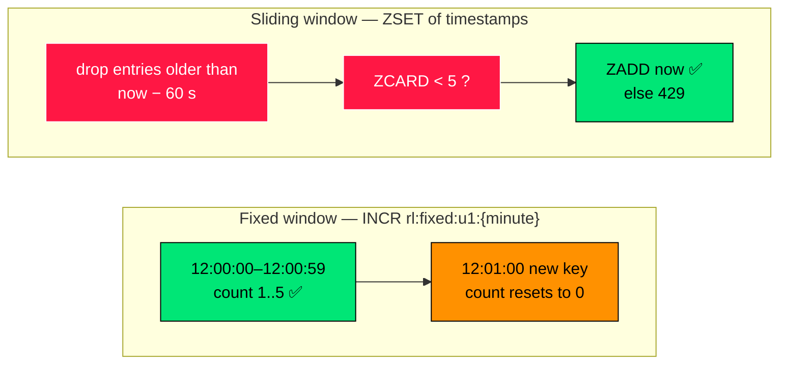
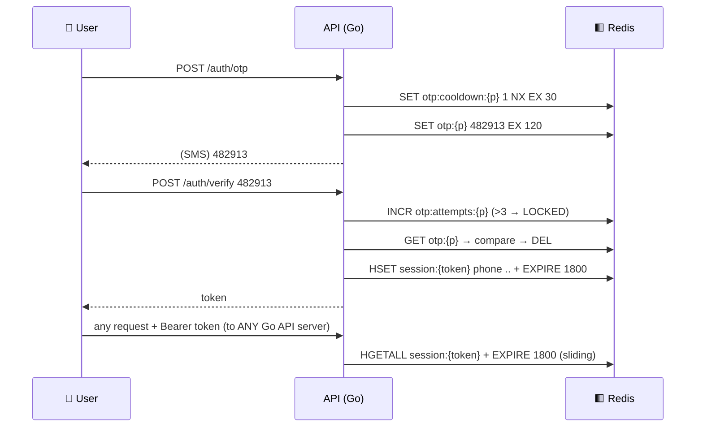

# 🟥 Track B — Protection: rate limiter + OTP login (Go Edition)

**Files:** `ratelimiter.go`, `otpauth.go`  **Check:** `./run.sh check B` (or `go run . check B`)  **Demo cards:** 1 (Log in), 4 (Spam the API)

## Warm-up in `redis-cli` (10 min)
```bash
INCR rl:fixed:u1:100          # 1
INCR rl:fixed:u1:100          # 2
EXPIRE rl:fixed:u1:100 60

ZADD rl:sliding:u1 1000 a 2000 b 3000 c
ZREMRANGEBYSCORE rl:sliding:u1 0 1500      # drops "a"
ZCARD rl:sliding:u1
ZRANGE rl:sliding:u1 0 0 WITHSCORES        # the oldest

EVAL "return redis.call('INCR', KEYS[1])" 1 counter     # your first Lua script

SET otp:cooldown:999 1 NX EX 30            # OK
SET otp:cooldown:999 1 NX EX 30            # (nil)  <- "already exists"
HSET session:abc phone 999 createdAt 1731
HGETALL session:abc
```

## B1 — Rate limiter



| TODO | Function | Description |
|---|---|---|
| 1 | `FixedWindow(userID string, limit int, windowSeconds int)` | `INCR` + `EXPIRE` on the first hit (atomic counter) |
| 2 | `SlidingLua` + `SlidingWindow(userID string, limit int, windowMs int64)` | ZSET log of timestamps; all steps executed in **one atomic Lua script** |

---

## B2 — OTP + sessions



| TODO | Function | Description |
|---|---|---|
| 1 | `RequestOtp(phone string)` | Cooldown with `SET NX EX`, store code with TTL |
| 2 | `VerifyOtp(phone, code string)` | Attempts counter → lockout, verify code, one-time use, create session |
| 3 | `Session(token string)` | `HGETALL` + sliding `EXPIRE` |
| 4 | `Logout(token string)` | `DEL session:{token}` |

---

## Think & Answer

1. **The boundary burst:** With a fixed window of 5 requests/min, how can a client send 10 requests in 2 seconds? Try it on the demo page at `hh:mm:58`. Why does the sliding window log eliminate this issue?
2. The sliding window stores one ZSET entry per request. A user allowed 1,000 req/min consumes how much memory in Redis? What is a cheaper middle-ground algorithm? (Look up: "token bucket", "leaky bucket", "sliding window counter").
3. Why does the sliding window *require* an atomic Lua script, whereas the fixed window is safe with a simple Redis `INCR`?
4. A 6-digit OTP has 1,000,000 combinations. With 3 attempts per code and a 30 s cooldown between requests, roughly how long would a brute-force attack take? What other layers of defense should you add? (e.g. rate-limiting by IP, max OTPs per phone per day).
5. Why must you increment and check the attempt count **before** checking the OTP code?
6. **Redis sessions vs. Stateless JWTs:** How do you invalidate a session across all devices with each approach? What happens if Redis goes down for both approaches?
7. If Redis is unavailable, should your rate limiter **fail open** (allow traffic) or **fail closed** (reject traffic)? Does your answer differ between `/auth/otp` and `/checkout`?

### Go-Specific Engineering Perspective
* **Local vs. Distributed Rate Limiting**: In Go, `golang.org/x/time/rate` provides an efficient token bucket rate limiter in memory. When would you use Go's in-memory limiter instead of Redis, and why is Redis mandatory once you have 10 Go replicas behind a load balancer?
* **Cryptographic Randomness**: In Go, why should OTP codes and session tokens be generated using `crypto/rand` rather than `math/rand`?

---

## Stretch Goals
- Implement a token bucket in Lua (`HSET bucket tokens lastRefill`), allowing bursts of 10 requests with a steady refill rate of 1 token/sec.
- Support "Log out of all devices": maintain `user:{phone}:sessions` as a `SET` of active tokens.
- Add `X-RateLimit-Remaining` and `X-RateLimit-Reset` headers to every API response.
