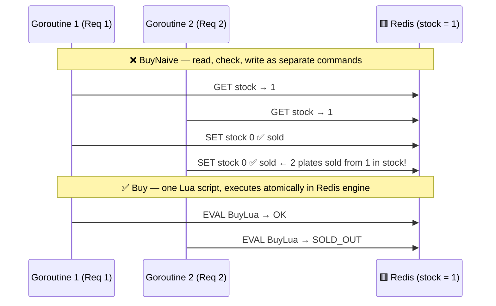
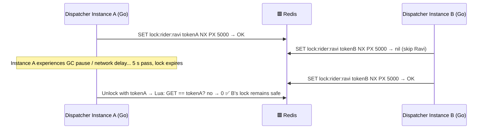

# 🟧 Track C — Correctness: flash sale + distributed lock (Go Edition)

**Files:** `flashsale.go`, `riderlock.go`  **Check:** `./run.sh check C` (or `go run . check C`)  **Demo card:** 5 (Flash sale)

## Warm-up in `redis-cli` (10 min)
```bash
SET sale:test:stock 2
EVAL "local s = tonumber(redis.call('GET', KEYS[1])) if s > 0 then return redis.call('DECR', KEYS[1]) end return -1" 1 sale:test:stock
# run it 3 times: 1, 0, -1

SET lock:rider:ravi tokenA NX PX 10000     # OK
SET lock:rider:ravi tokenB NX PX 10000     # (nil)
PTTL lock:rider:ravi
```
Run `./run.sh check C` **before** writing any code and observe the `[INFO]` line. `BuyNaive` sells far more than the available inventory. That is the critical concurrency bug you are fixing.

---

## C1 — Flash sale



| TODO | Function / Constant | Description |
|---|---|---|
| 1 | `BuyLua` | SISMEMBER → GET → DECR + SADD, all executed in **one atomic script** |
| 2 | `Buy(saleID, userID string)` | Run `BuyLua` via `RedisEval` and return the status ("OK", "SOLD_OUT", "ALREADY_BOUGHT") |

---

## C2 — Distributed lock



| TODO | Function | Description |
|---|---|---|
| 1 | `TryLock(name string, ttlMs int64)` | `SET NX PX` with a unique random token (non-blocking) |
| 2 | `UnlockLua` + `Unlock(name, token string)` | Compare-and-delete atomically in Lua |
| 3 | `AssignRider(orderID string, candidates []string)` | Lock candidate → verify free → assign → unlock (in `defer` / cleanup) |

---

## Think & Answer

1. `DECR` alone is an atomic Redis command. Why can't we simply `DECR stock`, and if the resulting value is negative, `INCR` it back? What goes wrong for users during a high-concurrency flash sale?
2. Lua scripts block the single-threaded execution of Redis while running. What happens to every other feature in QuickBite if a developer writes a Lua script containing a loop over 1,000,000 items?
3. Why does a distributed lock require an expiry (`PX` in milliseconds)? And why does that very expiry create the "slow holder / late unlock" problem the checker tests?
4. Look closely at `AssignRider`. Could `SET rider:{id}:order {orderId} NX` replace the separate lock entirely? When do you genuinely need a distributed lock rather than a single atomic command?
5. The lock lives on a single Redis master node. If that node crashes and fails over to an asynchronous replica before replicating your lock key, two dispatchers can both acquire the lock. Read about the **Redlock algorithm** and Martin Kleppmann's critique ("How to do distributed locking"). In your own words: when is a Redis lock "good enough", and when must you use fencing tokens or consensus systems (etcd/Consul)?
6. 20,000 users attempt to purchase 100 plates. After the sale concludes in Redis, how do you safely persist the 100 orders into Postgres without data loss if a server crashes midway? (Hint: See Track E's durable Redis Stream).

### Go-Specific Engineering Perspective
* **Goroutines & Race Conditions**: In Go, `sync.Mutex` protects memory between goroutines in the same binary. Why will `sync.Mutex` fail completely in production when your application is scaled out to 5 Kubernetes pods?
* **Resource Cleanup with `defer`**: In Go, why is `defer Unlock(lockKey, token)` the idiomatic way to release locks? What happens if you forget `defer` and a panic or early `return` occurs?

---

## Stretch Goals
- Build a "waiting list": after the flash sale sells out, enqueue the next 50 user requests into a Redis `LIST` (`RPUSH`), and promote them if an order is canceled.
- Implement a lock with a **heartbeat / auto-renew watchdog goroutine** that periodically extends the lock's `PTTL` while the operation is still executing.
- Broadcast live remaining stock to connected clients using Track E's Pub/Sub and display a real-time countdown on the dashboard.
