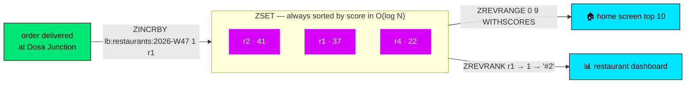
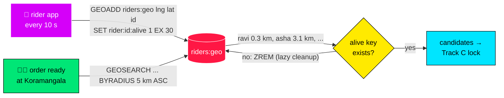

# 🟪 Track D — Real-time data: leaderboard + nearby riders (Go Edition)

**Files:** `leaderboard.go`, `nearbyriders.go`  **Check:** `./run.sh check D` (or `go run . check D`)  **Demo cards:** 6 (Top restaurants), 7 (Riders)

## Warm-up in `redis-cli` (10 min)
```bash
ZINCRBY lb:test 1 r1
ZINCRBY lb:test 5 r2
ZINCRBY lb:test 3 r3
ZREVRANGE lb:test 0 2 WITHSCORES      # highest first
ZREVRANK lb:test r3                   # 0-based rank
ZSCORE lb:test r3

GEOADD riders:test 77.6245 12.9352 ravi        # LONGITUDE first!
GEOADD riders:test 77.6412 12.9719 imran
GEODIST riders:test ravi imran km
GEOSEARCH riders:test FROMLONLAT 77.626 12.934 BYRADIUS 5 km ASC WITHDIST
TYPE riders:test                      # zset! GEO is a sorted set storing geohashes as scores
```

## D1 — Leaderboard



| TODO | Function | Description |
|---|---|---|
| 1 | `RecordOrder(board, restaurantID string)` | `ZINCRBY` + `EXPIRE` 8 days |
| 2 | `TopLeaderboard(board string, n int)` | `ZREVRANGE ... WITHSCORES` → entries with 1-based ranks |
| 3 | `RankOf(board, restaurantID string)` | `ZREVRANK` + `ZSCORE` |

---

## D2 — Nearby riders



| TODO | Function | Description |
|---|---|---|
| 1 | `UpdateLocation(riderID string, lat, lng float64)` | `GEOADD` (longitude, latitude!) + heartbeat key |
| 2 | `Nearby(lat, lng, radiusKm float64, limit int)` | `GEOSEARCH ... WITHDIST`, filter and `ZREM` dead riders |
| 3 | `GoOffline(riderID string)` | `ZREM riders:geo` + delete alive heartbeat key |

---

## Think & Answer

1. Why is a sorted set's `ZINCRBY` (O(log N)) and top-10 read so vastly cheaper than `SELECT restaurant_id, COUNT(*) ... GROUP BY 1 ORDER BY 2 DESC LIMIT 10` on 50 million relational order rows?
2. Generating a new key per ISO week (`time.Now().ISOWeek()`) automatically resets the weekly leaderboard. How would you build a "Top restaurants of the **month**" view from these weekly boards? (Hint: Check Redis `ZUNIONSTORE` with weights).
3. If two restaurants have the same order count (e.g. both have 37 orders), what determines their ordering in Redis? How would you implement a tie-breaker so that whoever reached 37 orders *first* gets the higher rank?
4. Why can't we attach a TTL directly to an individual member inside `riders:geo`? Why is a separate `rider:{id}:alive` key necessary?
5. If 50,000 active riders transmit their GPS coordinates every 5 seconds, that equals 10,000 writes per second. Can a single Redis master handle this throughput? How would you shard riders across multiple Redis instances?
6. Our architecture cleans up offline riders lazily (when a nearby search is executed). What is the operational downside of this approach, and how could you proactively purge offline riders in a background Go goroutine?

### Go-Specific Engineering Perspective
* **Geohashes & Wire Protocol**: Redis GEO commands store 52-bit geohash integers as sorted set scores. When parsing `GEOSEARCH ... WITHDIST` replies in Go, how do you handle coordinate precision and floating-point conversions?
* **Time Handling**: In Go, `time.Now().ISOWeek()` returns `(year, week)`. Why is this format preferable to `time.Now().Format("2006-01-02")` when building rolling weekly business aggregates?

---

## Stretch Goals
- Implement `Around(board, restaurantID, radius int)`: display the 2 restaurants immediately above and below a given restaurant ("You're #7: see who is right ahead of you!").
- Build a dish-level leaderboard: `lb:dishes:{restaurantId}:{week}`.
- Implement `GEOSEARCH ... BYBOX` for map-based bounding box queries, and plot each rider in real time on the demo page.
