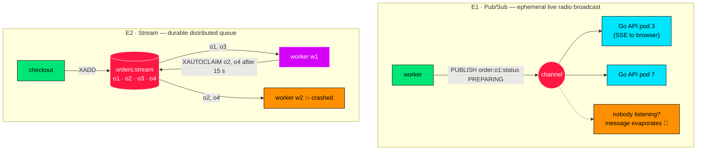

# 🟩 Track E — Events + glue: Pub/Sub, Streams, checkout, kitchen worker (Go Edition)

**Files:** `liveupdates.go`, `orderpipeline.go` (E1/E2, one or two owners), and `checkout.go`, `kitchenworker.go` (I1/I2, **the entire team**)  
**Check:** `./run.sh check E` (or `go run . check E`)  **Demo card:** 3 (Order: checkout + live timeline)

## Warm-up in `redis-cli` (15 min, open 3 terminals)
```bash
# Terminal 1                        # Terminal 2
SUBSCRIBE order:o1:status           PUBLISH order:o1:status hello     # -> (integer) 1
                                    PUBLISH order:o2:status hello     # -> 0: nobody listening, message is lost!

XADD orders:test * orderId o1 restaurantId r1
XADD orders:test * orderId o2 restaurantId r2
XRANGE orders:test - +                              # the stream log retains every event
XGROUP CREATE orders:test kitchen 0
XREADGROUP GROUP kitchen w1 COUNT 1 STREAMS orders:test >     # w1 receives o1
XREADGROUP GROUP kitchen w2 COUNT 1 STREAMS orders:test >     # w2 receives o2 (never duplicate)
XPENDING orders:test kitchen                         # 2 pending: delivered but unacknowledged
XACK orders:test kitchen <id of o1>
XAUTOCLAIM orders:test kitchen w1 0 0-0              # w1 rescues w2's pending unacked entry
```

---

## Pub/Sub vs. Streams — Why We Need Both



| TODO | Location | Function | Description |
|---|---|---|---|
| E1-1 | `liveupdates.go` | `PublishLive(orderID, status string)` | `PUBLISH` a JSON status to `order:{orderId}:status` |
| E1-2 | `liveupdates.go` | `ListenLive(orderID string, listener LiveListener)` | `RedisSubscribe` loop with idle keep-alives |
| E2-1 | `orderpipeline.go` | `(p *OrderPipeline) Add(fields map[string]string)` | `XADD ... MAXLEN ~ 100000 *` |
| E2-2 | `orderpipeline.go` | `(p *OrderPipeline) ReadNew(consumer string, count int, blockMs int64)` | `XREADGROUP ... BLOCK ... >` |
| E2-3 | `orderpipeline.go` | `(p *OrderPipeline) Ack(id string)` | `XACK` to acknowledge processed entries |
| E2-4 | `orderpipeline.go` | `(p *OrderPipeline) ClaimStuck(consumer string, minIdleMs int64, count int)` | `XAUTOCLAIM` for dead-worker rescue |
| **I1** | `checkout.go` | `Checkout(token string)` | Session → rate limit → cart validation → stream enqueue → cart clear → publish |
| **I2** | `kitchenworker.go` | `ProcessOrder(e StreamEntry)` | Publish status lifecycle, bump leaderboard, find nearby rider, acquire lock, deliver, release |

---

## Running the Complete System End-to-End

```bash
./run.sh                       # Terminal 1: Go API Server on :8080
./run.sh worker w1             # Terminal 2: Kitchen Worker w1
./run.sh worker w2             # Terminal 3: Kitchen Worker w2
```

1. Open **http://localhost:8080** in your browser.
2. Log in with OTP (Card 1) → Add dosas to cart (Card 3) → Click **Checkout ▶**.
3. Watch the live timeline transition through `PLACED` → `ACCEPTED` → `PREPARING` → `OUT_FOR_DELIVERY` → `DELIVERED`!
4. **Crash Recovery Test:**
   ```bash
   ./run.sh worker w9 --crash  # Place another order: if w9 claims it, it crashes without XACK...
                               # ...15 seconds later, w1 or w2 rescues the pending order!
   ```

---

## Think & Answer

1. Pub/Sub permanently drops messages when no subscribers are active. Why is that completely acceptable for live UI status animations, but catastrophic for an order checkout queue? How does a client recover if its SSE connection drops for 5 seconds? (Hint: Exercise 03's `Last-Event-ID` or querying current order status).
2. A stream message is processed by a kitchen worker, but the worker process dies **before** calling `XACK`. The entry is claimed and re-processed by another worker. Which of your processing steps are naturally idempotent, and which are not? How do you guarantee idempotency in `ProcessOrder`?
3. Why do we use `MAXLEN ~ 100000` (with a tilde approximation) instead of an exact `MAXLEN 100000`? (Hint: Redis stream macro-nodes and Radix tree allocation performance).
4. **Redis Streams vs. Apache Kafka:** Name two distinct enterprise capabilities Kafka provides that Redis Streams lack (e.g. partition scaling, disk-backed archival), and name one compelling architectural reason to choose Redis Streams anyway (e.g. operational simplicity, unified memory cache & queue).
5. **Checkout execution sequence:** Why verify the rate limit *before* inspecting the user's cart? Why write to the Redis Stream *before* clearing the cart? What would happen if a server panic occurred between those steps if the order was inverted?
6. If no delivery rider is available in the radius, `ProcessOrder` returns an error without calling `XACK`, leaving the order pending to be retried later. What is a "poison pill" message in message queue architectures, and how do you prevent infinite retry storms? (Hint: Delivery counters in `XPENDING`).

### Go-Specific Engineering Perspective
* **SSE & `http.Flusher`**: In Go, real-time HTTP streaming is built directly on standard library `net/http` using the `http.Flusher` interface. How does `ListenLive` feed Redis Pub/Sub messages into Go's HTTP response stream?
* **Worker Pools & Context Cancellation**: In production Go applications, how would you structure `KitchenWorker` using `context.WithCancel` and `os.Signal` (e.g. `syscall.SIGTERM`) to achieve graceful drain and shutdown in Kubernetes?

---

## Stretch Goals
- **Dead-letter queue (DLQ):** After 3 failed delivery attempts (inspecting the delivery counter from `XPENDING`), move the stuck entry to an `orders:dead` stream and trigger an alert.
- **Idempotency guard:** Use `SET order:{id}:done 1 NX EX 86400` inside `ProcessOrder` to ensure duplicate deliveries never double-charge or double-dispatch.
- Stream simulated rider GPS coordinates every second while `OUT_FOR_DELIVERY` via Pub/Sub and render live moving markers on the demo page.
